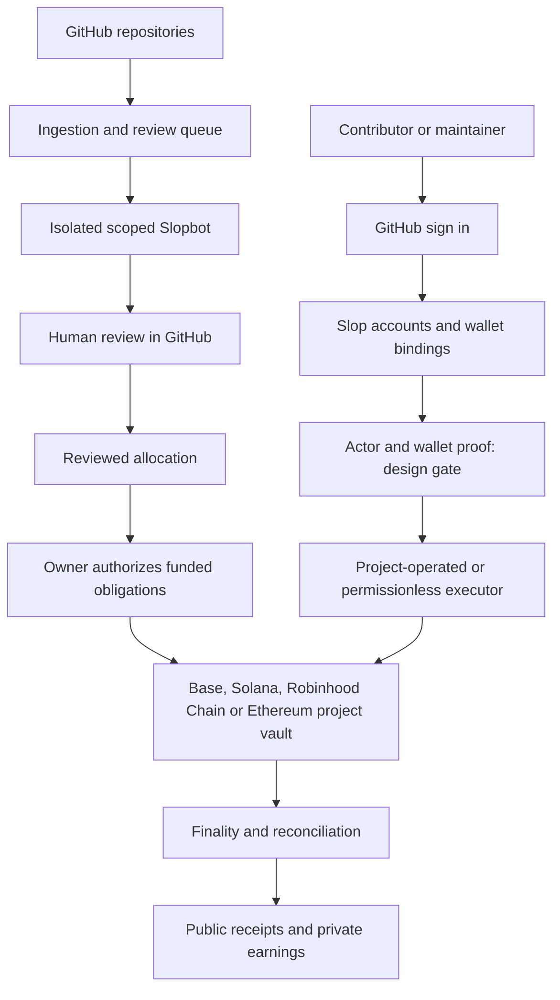

# Slop Product Requirements

Date: 6 October 2026. Private bounty scope revised 13 October 2026 and approved by the repository owner on 14 October 2026. Project-token reward scope added: 13 October 2026; project-token fee settlement decided: 14 October 2026. Simplification decisions (D1 project registry, generated project skills, one funding mode, one deposit bucket, 5% withdrawal fee, any-decimals tokens, fee-wallet conversion in the MVP and cached public reads) recorded by the product owner on 18 October 2026. Status: MVP requirements submitted for maintainer adoption; unresolved implementation decisions remain explicit.

## 1 Executive summary

Slop helps people make money shipping open source. Contributors find useful work, use their preferred agent or model, and submit changes in GitHub. Maintainers decide what to accept. Slop records contribution quality, calculates rewards under published rules, and shows evidence of completed payments.

The next MVP turns the current collection of project pages, contribution skills, identity services, and payment tools into one coherent product. A person signs in with GitHub, gets a Slop account, optionally connects X, and manages their payout wallets in Slop. A maintainer connects a repository, publishes contribution rules, configures Slopbot, funds a project vault on Base, Solana, Robinhood Chain or Ethereum, and approves contributor rewards in the network stablecoin or a supported project token (TOK-01–07). Anyone can deposit into a project vault. All free funds in a vault are refundable only to the project owner's refund destination, and the deposit flow tells the depositor this before signature (FND-03).

GitHub remains the authority for repository work, acceptance, and public project policy. Slop's backend becomes the authority for account settings, verified social connections, wallet bindings, sessions, notifications, and operational state. Finalized chain evidence establishes deposits, protected awards, fees, withdrawals, and payments. None of these authorities substitutes for another.

The core product outcome is a complete, understandable journey from finding work to receiving a verified payment. A wallet form, points page, vault balance, or bot review alone does not complete that journey.

The MVP includes the current product capabilities, unified accounts, contributor and maintainer onboarding, project discovery, contribution and review skills, optional operated Slopbot, community-project security vetting, points and Slop Score leaderboards, permissionless vault deposits, and a complete escrow payout path on Base, Solana, Robinhood Chain and Ethereum (FND-02) with stablecoin or supported project-token rewards (TOK-01–07). Adding a network or an asset activates no project. Opt-in private security bounty programs are an MVP addition under section 19, approved by the repository owner on 14 October 2026. Fee-wallet conversion of project-token fees to the network stablecoin (TOK-07) is an MVP addition from 18 October 2026. Other Robinhood integrations and additional chains are future scope. The project vault is the only funding mode (FND-01). The removed legacy funding modes and settlement rail keep their historical records in git history.

This draft defines target behavior. It does not authorize a release, financial transaction, contract deployment, new fee, or retrospective change to contributor terms.

## 2 Product overview and success criteria

### Users and jobs

| User | Main need | Successful result |
| --- | --- | --- |
| Contributor | Find work that the project wants and understand how to earn | Accepted work, a clear reward decision, and a verified receipt |
| Human reviewer | Help maintainers assess useful work | Recognized review outcomes under the project's active policy |
| Maintainer | Get useful contributions without an unmanageable review queue | Clear guidelines, actionable reviews, approved work, and reconciled payments |
| Sponsor or depositor | Fund a project with visible results | A verified deposit and understandable use of funds |
| Slop operator | Keep identity, data, review, and payment services reliable | Auditable decisions and recovery without hidden changes to awards |
| Security researcher | Report a valid vulnerability privately and receive the disclosed 75% share | Safe intake, triage, remediation, and a private payout record |

### Goals

1. Let a new contributor reach suitable, unblocked work without understanding Slop's internal protocols.
2. Make account and wallet setup a normal website flow, with no GitHub bio edits, wallet issues, or wallet PRs.
3. Let maintainers publish a project and manage its lifecycle from one dashboard while retaining GitHub approval authority.
4. Make available funds, reserved awards, and money actually paid easy to distinguish.
5. Reduce review effort through optional Slopbot reviews and explicitly delegated closure rules. Keep accepted-work ratification and payment approval with maintainers; apply published penalties through deterministic accounting.
6. Make Base, Solana, Robinhood Chain and Ethereum behave consistently at the product level, with explicit network differences where users need them.

### Measures

The primary outcome measure is unique contributors with accepted work and a finalized payment in a UTC month. Pair it with maintainer satisfaction and review effort; payment volume alone can reward circular transfers.

Track the funnel from project visit, sign-in, suitable work selection, first PR, first maintainer response, accepted outcome, approved award, and finalized payment. Also track returning contributors, active funded projects, time to first useful contribution, maintainer review time, payment completion rate, reconciliation discrepancies, wallet recovery incidents, bot findings confirmed or overturned, and appeal resolution time.

Suggested pilot targets are product targets, not observed performance: at least 80% of usability participants complete account setup without help; at least 90% can correctly identify available funds versus projected rewards; all eligible test obligations pay exactly once; all displayed financial totals reconcile. Set conversion and retention targets after a four-week baseline. Do not optimize for tokens consumed, PR volume, points issued, or nominal vault deposits.

## 3 Scope and current baseline

### Scope labels

- **Existing:** present in the inspected source. This does not imply production activation or end-to-end verification.
- **MVP addition:** required to complete the requested product; implementation and activation remain gated by approved requirements and evidence.
- **Future:** outside the MVP and must not appear as a working capability.

| Capability | Existing baseline | Target scope |
| --- | --- | --- |
| GitHub registration | OAuth identity worker and separate points membership session | MVP: one account experience with properly scoped sessions |
| X connection | OAuth connection, opt-in display, one-time points | MVP: expose within account settings; verify live provider activation |
| Wallet records | Append-only backend claims; independent Base and Solana lineages | MVP: unified wallet UX, independent Robinhood Chain and Ethereum lineages, possession/consent rules, recovery, and payout binding |
| Wallet page | Inspected form validates Solana addresses | MVP: every supported network and network-specific status |
| Contribution skills | General bootstrap plus canonical project contributor/reviewer skills | MVP: discovery without an existing checkout; project skills generated from the D1 project revision with one canonical generic template (SKL-03) |
| Work selection | GitHub ingestion and bounded eligibility decisions | MVP: explain eligibility and recheck before starting |
| Slopbot | Advisory protocol and project reviewer skills | MVP: optional GitHub App, participation filters, ignore lists, full guideline review, health status, delegated closure and auditable penalties |
| Project onboarding | Form stores an application in the D1 registry; an admin approves it at `/admin` | MVP: authenticated, resumable setup with verified repository authority; no GitHub PR to add or update a project (PRJ-02) |
| Featured/community | Manifest listing tiers and promotion gates | MVP: permissionless submission, mandatory secure-VM vetting, admin featuring and project bans |
| Points | Durable journal, membership, X, contribution and recipient payout points | MVP: explicit setup and maintainer recognition without changing cash scores |
| Leaderboards | Current project cycles, cumulative score, points standings, archive | MVP: Slop Score by default, points and money-received sorting, issue/PR outcome ratios and negative events |
| Funding | Legacy direct funding records and Squads/Sablier commitment verification (removed 18 October 2026; history in git) | MVP: one funding mode, the project vault contract; permissionless deposits into one bucket; free funds refundable only to the owner's refund destination (FND-01–05) |
| Payouts | Deterministic allocations; the legacy unsigned Solana or Base plan rail (PAY-09) is removed and its history stays in git | MVP: complete Base, Solana, Robinhood Chain and Ethereum escrow reserve, approval, execution, and reconciliation paths, with stablecoin or project-token rewards under TOK-01–07 |
| Private traces | Dedicated R2 storage and scoped metadata/authorization | Retain applicable protocol; do not reuse as a private bounty case system |
| Security bounty business | No complete private program workflow established by this review | MVP: opt-in private loss-of-funds programs; project-specific gross amount, 75% researcher / 25% Slop split |
| Other networks/products | Legacy Ethereum/Bitcoin funding readers (removed with the legacy funding modes) and external prize records | History stays in git; Ethereum and Robinhood Chain escrow settlement are MVP under FND-02 and TOK-01–07; other Robinhood products and further networks are future |

The current upstream source uses Score v2. The supplied local instructions describe older diminishing-credit behavior and stricter trace requirements. These must not be combined into a new accidental policy. This PRD preserves the source baseline for analysis and calls for one approved versioned policy before implementation. The requested Slopbot closures, penalties, and security-based project bans are target MVP policy changes. They require versioned protocol and runtime changes before activation; publication of this PRD does not activate them.

### Explicit exclusions

No token launch, speculative points benefit, paid placement disguised as featuring, contribution submission fee, automatic merging, unrestricted model-selected sanctions, wallet-based login, private-key collection, cross-chain bridge, asset swap in a payment path, or automatic copyright assignment is required for the MVP. The only swap in the MVP is the TOK-07 fee-wallet conversion, which acts only on fees that Slop's fee wallet has already received.

### MVP first and human-responsible issues

Only the approved MVP packages in the companion plan may be implemented now. Contributors must review and reference the PRD/MVP before proposing work; a new requirement must be added to the PRD and approved by humans before implementation. Future work starts only after maintainers record that the complete MVP is finished, verified, tested and validated against every release gate, then approve the next phase. No agent, local green suite or individual merged PR can declare that transition.

Slop participation issues are chosen, verified and personally submitted by a human on the website. Banned: unattended generation of issue text, bulk creation, delegated submission through any UI, API, CLI, script, prefilled link or agent, and reports the human has not understood. Allowed under human control: investigation, outlining, explanation of findings, translation, grammar correction, accessibility tools and source checking. The rule covers this repository and any tracker where an issue claims Slop participation; it does not govern unrelated third-party activity. Style, fluency or tool use is not evidence of a breach; an adverse decision needs objective evidence and the ELG-02 appeal path, and the rule applies prospectively from its published effective date (`CONTRIBUTING.md`). It does not prohibit authorized PR work or review/closure of an existing issue under the applicable policy. Private report automation remains future scope under SEC-07 and is not a public-issue exception.

## 4 Product principles and authority

| Record or decision | Authority | Slop's role |
| --- | --- | --- |
| Repository identity, work, merge, review | GitHub immutable IDs and current permissions | Ingest, link, and verify |
| Project rules and approved configuration | Append-only D1 project revision approved by an admin at `/admin` | Store revisions, generate skills from the canonical template, and publish cached derived views |
| Account and social settings | Authenticated backend account | Store settings and enforce visibility |
| Wallet destination | Authenticated actor plus approved wallet proof and consent | Keep append-only bindings and audit changes |
| Award amount | Published rules and authorized human decision | Calculate and propose; validate approval |
| Funded obligation | Approved commitment enforced by the supported vault | Index and reconcile |
| Paid state | Finalized exact settlement evidence | Verify and publish receipts |
| Featured status or abuse sanction | Authorized admin decision or explicitly approved standing security rule | Record reasons, enforce scoped quarantine/ban, and support appeal |
| Slopbot closure and penalty | Enabled project closure policy, verified bot action, versioned penalty schedule | Execute the delegated action and append deterministic score/points events |

GitHub stewardship does not prove legal ownership or authority over a wallet. A device signature does not prove provider billing or model execution. A Slop account does not prove a unique human. A listed project does not establish that funds are available.

## 5 Accounts and registration

**ACC-01 — GitHub account creation.** Sign in with GitHub is the only MVP login method. Use immutable numeric and node IDs as identity keys; handles are display aliases. A rename must preserve contributions, points, and claims. A reused handle must never inherit the prior actor's account.

After OAuth, show the verified GitHub identity and a short setup screen. Require applicable account terms and privacy acknowledgement. Offer a display name, public-profile preference, and notification settings. Defer X and wallets until the user chooses them or needs payment. New membership remains private until the user opts into directory display; public GitHub contribution records remain public regardless.

**ACC-02 — One account surface.** The account menu leads to Profile, Payouts, Wallets, Connections, Notifications, and Sessions. A visible checklist explains optional versus required setup. Registration must succeed without a wallet, X account, repository installation, or contribution skill.

**ACC-03 — Session boundaries.** Reuse the identity worker, but issue distinct scopes for web account actions, installed contribution clients, and operators. An account session cannot read traces, import awards, approve payments, or become an operator. Use secure HTTP-only cookies, CSRF protection, expiry, server-side revocation, and recent authentication for wallet changes. Do not put capabilities in public URLs, receipts, model context, or analytics.

**ACC-04 — Recovery.** Lost GitHub access starts a private support case. Never reassign an account based on an X handle, email claim, GitHub display name, or screenshot. Recovery requires an approved evidence policy and two authorized operators for any identity or payout redirection. Preserve prior bindings, notify the account through available verified channels, and freeze affected unpaid routing while unresolved. Recovery cannot recall a completed transfer.

**ACC-05 — Account closure.** Disable sessions, social visibility, notifications, and new account activity. Explain which public contribution and financial records remain, and which private data can be removed under the approved retention policy. Do not promise deletion of immutable chain records or existing permanent traces. Resolve unpaid awards before final closure, or retain a minimal claimant record and recovery path.

### X connection

**SOC-01.** Connect X only from a signed-in GitHub account, using OAuth with state and PKCE. Verify the provider's stable account ID. Linking, public display, and notifications are separate choices. No posting, following, messaging, follower import, or ongoing social monitoring is necessary.

Preserve the existing minimal-storage design: account ID, observed handle, verification time, and visibility; no persistent provider token or refresh token. Reconnection refreshes a changed handle. Disconnect hides the link and revokes access where supported; it cannot reissue the connection award. Conflicting connections enter recovery rather than silently moving another person's identity. X failure never blocks GitHub work or payments. The provider's documented authorization flow supports scoped PKCE authorization; live access remains an activation dependency. [X OAuth documentation](https://docs.x.com/fundamentals/authentication/oauth-2-0/authorization-code)

## 6 Wallets and payment identity

**WAL-01 — Backend ownership of the record.** Store all new account-to-wallet connections through Slop's authenticated API. No GitHub bio, issue, PR, commit, or manually edited manifest is a normal registration path. Legacy records remain historical evidence and require explicit migration provenance; they do not automatically become authorization for a new payout protocol.

One account may have one active destination per supported network: Base, Solana, Robinhood Chain and Ethereum. A project's settlement network selects the appropriate destination. An EVM address registered for one network does not establish readiness on another, because the consent message and the binding digest name the chain id: a Base registration does not establish Robinhood Chain or Ethereum readiness, and the reverse. Show full addresses on confirmation and copy actions, network, token, verification state, and last change time.

**WAL-02 — Proof and consent.** Connecting a wallet provider is not proof by itself. Use a short-lived, single-use signature challenge bound to actor, origin, network, exact destination, purpose, and expiry. The message authorizes payout routing only. It must not request token approval, a transaction, a seed phrase, or a private key. Separately capture agreement to receive awards at that destination.

The MVP initially supports ordinary self-controlled Base, Solana, Robinhood Chain and Ethereum wallets with verified signatures. Contract wallets, multisigs, exchange deposit addresses, and off-curve Solana destinations need an explicit supported proof method or reviewed exception; an unsupported wallet receives a useful explanation and remains ineligible for automatic routing. Preserve historical claims without falsely upgrading their proof level.

**WAL-03 — Changes.** A change appends a successor to the current actor/network lineage. Use compare-and-swap semantics so two concurrent changes cannot create competing current wallets. Require recent GitHub authentication and fresh proof for the new destination. Recommended default: a 24-hour delay for changes affecting unpaid funded awards, with an immediate security freeze option. Show the activation time and affected obligations.

Unpaid, unbound obligations use the active verified binding after the delay. Once an obligation is execution-bound, hold its destination revision fixed through finality. A pending transaction cannot race a wallet update into two payments. After a failed attempt is conclusively reconciled, a new binding may be explicitly attached to a retry. Never mark an ambiguous transaction failed merely because an RPC timed out.

**WAL-04 — Privacy.** Keep account metadata and pending bindings private. Public chain transfers inevitably reveal addresses. Publish only the wallet/receipt data needed for an approved public settlement record. Moving storage into the backend does not make previously published or on-chain addresses private. Existing public wallet APIs need a compatibility and privacy migration, not an undocumented shutdown.

**WAL-05 — Walletless earnings.** Account registration and wallet registration are not prerequisites for recognizing public accepted work. A funded award may identify an immutable GitHub actor before their first login. After login and valid network wallet binding, display and dispatch eligible unpaid awards without making the user wait for another monthly cycle.

## 7 Contributor journey

1. **Discover.** Browse projects without logging in. See the project's status, settlement network, available funding, contribution rules, response history, and suitable work.
2. **Choose.** Select a project and a bounded issue, or let the general skill suggest eligible projects. Explain why an item is blocked. A visible queue item is not a reservation or guarantee of acceptance.
3. **Join.** Sign in with GitHub when saving personal progress or setting up payment. Reconcile the website identity with the GitHub CLI identity before a skill submits work.
4. **Prepare.** Read the project's approved scope, contribution rules, and effective reward policy. Install the canonical skill and inspect its requested access. Declining optional telemetry must follow the project's actual receipt policy, not an invented universal rule.
5. **Work.** Recheck live assignment and review state. Make a bounded useful change, test the real workflow, and prepare exact-head evidence. Do not create unnecessary issues or PRs to earn points.
6. **Submit.** Open the PR with problem, requirement, result, implementation choice, tests, required model/client attribution, and the visible `Made via @slopdotcash` line. Contributors must write and submit outside issues themselves on the website; agents must not draft or submit them. Never include wallet details or sensitive trace content. If enabled and eligible, Slopbot reviews the exact head under the project rules; maintainers retain acceptance authority.
7. **Respond.** Address useful findings. A new commit makes old head-specific conclusions stale. Show pending human review separately from automated review completion.
8. **Earn.** After acceptance and scoring, show contribution points and a projected cash share. Explain that review, funding, and approval still apply.
9. **Receive.** Show approved, funded, awaiting wallet, ready, submitted, and finalized status. Provide the action needed from the user and a receipt after settlement.
10. **Return.** Offer relevant next work based on explicit interests and prior accepted work, without requiring referrals or social actions.

Private dashboard entries link back to GitHub and never imply that Slop owns an issue. A user may contribute manually without an agent. Human-only work must use an explicit attribution mode rather than fabricated model identifiers; any policy requiring machine receipts needs a defined human equivalent or an explicit eligibility explanation.

### Public work and bounty terms

Public opportunities must state their reward mechanism. The current monthly-pool model gives accepted work a reviewed share; an issue is not a promise of a fixed payment. Use “share of the monthly pool” and show estimates as estimates. External-prize work retains its separate organizer-controlled terms and cannot enter ordinary platform settlement without an approved conversion.

A fixed-price public bounty, if separately approved, needs an explicit funded amount, acceptance criteria, duplicate/claim rules, expiry, authorized approver, and review/appeal process. It cannot also earn cash from the monthly pool for the same outcome unless the published policy explicitly funds and permits both. This draft does not infer an existing fixed-price engine from the phrase “open bounties.” Private security programs use the MVP workflow in section 19. Its bounty-only reward mode does not create a monthly-pool entitlement.

## 8 Main skill and project skills

**SKL-01 — General skill.** Support two entry modes: discover a project from anywhere, or detect the current repository. In discovery mode, query the generated project registry, show active eligible work and funding states, let the user choose, then clone or enter that repository with normal authorization. In repository mode, match the immutable repository identity and never silently switch projects.

The existing bootstrap assumes a checkout and fails when there is no unique match. Extend that behavior into useful discovery rather than bypassing matching checks. A project with no suitable work should say so and offer another project; it must not manufacture work.

**SKL-02 — Setup.** Check GitHub identity, tools, exact provider/model/client, current skill authorization, contribution scope, and evidence requirements. Show a short plan before installing or accessing local usage. Open browser-based account setup when needed; the agent receives only scoped success/status, not browser tokens or wallet secrets. Wallet signing stays in the user's wallet.

**SKL-03 — Generated project skills (owner decision, 18 October 2026).** The repository keeps one canonical generic contributor template and one canonical generic reviewer template. It keeps no per-project skill folder. Slop generates each project's contributor and reviewer skills from the project's approved D1 manifest revision and these templates. The revision supplies the maintainer-authored fields: approved scope, contribution guide, supported tasks, required tests, review expectations, security contact, closure policy and free-form maintainer notes. The template supplies the platform rules: live GitHub work selection, repository rules, evidence, attribution and the safety boundaries. Maintainer notes cannot remove or weaken a template rule. Derive Markdown endpoints, client guides, archives and checksums from the generated output. Generation is deterministic: the same template revision and D1 revision produce the same bytes. Do not maintain divergent embedded copies.

**SKL-04 — Provenance.** The trust root of a generated project skill is the pair (template revision on `main`, D1 revision digest). GitHub authorizes the template revision under the existing installer rules. The project registry API publishes the digest of the approved D1 revision. The installer regenerates or compares the exact bytes for that pair and refuses a mismatch. The D1 digest proves which approved revision the skill came from; it does not make Slop's database an independent trust root, so disclose that the maintainer-authored fields come from Slop's registry. Preserve exact tree verification, immutable installed versions, atomic activation, revocation checks, and explicit rollback. A checksum alone is insufficient. Revalidate authorization before a new run and before GitHub writes. A policy or source mismatch should explain the recovery action without running unverified code.

**SKL-05 — Work selection.** Agents may inspect existing issues, investigate and explain findings, and assist with editing or translation under the contributor's control, but must not generate unattended issue text, create issues in bulk, or open or submit an issue by any automated or delegated path. The contributor chooses the claims, verifies the evidence, and personally submits each Slop participation issue on the website, including its PRD/MVP references; the evidence standard, appeal path and effective date are in `CONTRIBUTING.md`. Respect assignments, maintainer claims, drafts, existing reviews, approvals, changes requested, security labels, human gates, and duplicate work. Use the existing deterministic decisions and repeat the live check before acting. Skills may suggest or request work; only GitHub actions under actual user authorization establish a claim.

**SKL-06 — Trace handling.** Read the effective project receipt policy and publish it clearly during setup. Never silently convert optional collection into mandatory collection or bypass a required receipt. Any allowed trace upload is contribution-specific, minimized, inspected and redacted by the contributor, and sent through the private protocol. Preserve aggregate usage as diagnostic only. Source policy conflicts listed in section 3 must be resolved before skill release.

**SKL-07 — Public attribution.** Every PR and issue submitted through Slop participation carries the visible body line `Made via @slopdotcash`, rendered as a GitHub organization mention. Add it once, outside code fences and hidden comments, alongside the existing structured attribution. All general/project skills and PR templates enforce it on PRs they create or update. Human contributors add it when they personally write issues on the website. No skill may generate or submit an issue to satisfy this branding requirement. Do not rewrite unrelated external submissions or add mentions through mass comments. The line is a participation signal, not a device signature or proof of account control.

## 9 Maintainer onboarding and project updates

**PRJ-01 — Add a project.** The maintainer signs in, chooses the repository, proves current administration or delegated Slop management authority, and optionally enables Slopbot. Slopbot is not a prerequisite for project funding, contribution, or payout. Any repository installation used for ingestion/authority is separately explained and can run with review disabled. Repository access and financial authority are separate. A GitHub App supports selected repository installations and narrow permissions; the permission set must match the actual API operations. [GitHub Apps documentation](https://docs.github.com/en/apps/creating-github-apps/about-creating-github-apps/about-creating-github-apps)

The setup wizard has five resumable steps:

1. Repository and maintainer identity: immutable IDs, integration branch, installation permissions, current license facts, and required community security-vetting status.
2. Contribution rules: approved scope, contribution guide, supported tasks, required tests, review expectations, attribution, security contact, optional Slopbot, review eligibility, ignored actors, closure policy, and free-form maintainer notes. These fields generate the project skills (SKL-03).
3. Rewards: monthly principal cap, optional additive review budget, reward exclusions, settlement network, exact reward asset, cap in that asset, fee preview, and effective month.
4. Funding: approved project vault deployment, owner refund destination, deposit terms, initial funding, and finality.
5. Review and submit: preview the public page and both generated skills; submit the revision to the D1 registry; show the admin approval and activation gates. An admin approval at `/admin` publishes the revision. No GitHub pull request adds or updates a project.

A draft can be saved before all fields are known. Unknown legal ownership stays unknown. Repository identity, public policy integrity, and money authority must meet their respective activation gates. A project can be listed as unfunded without advertising paid work.

**PRJ-02 — Permissionless community listing.** Anyone with verified repository authority may submit a compliant community project without editorial featuring approval. Permissionless means equal published admission rules, not anonymous authority claims or bypassed repository protections. The D1 project registry is the only active inventory. The applicant signs in with GitHub and submits an application on slop.cash; the API stores it and emails the admins. An admin approval lists the project as paused revision 1. Every later change is an append-only admin revision that must pass the policy transition check. The project becomes active only after an admin approves an activation revision whose generated skills pass review in the `/admin` preview, the authorized transition, and the mandatory security vetting in section 15 complete. Applications are not active projects. No GitHub pull request adds or updates a project, and the repository holds no project JSON or per-project skill folder.

A fully automatic listing transition would require a separately approved, narrow standing-review policy. Do not quietly give Slopbot admin or policy powers to remove this final admin gate. Measure proposal-to-listing time and disclose the review dependency.

**PRJ-03 — Defaults.** Recommend bounded approved work, evidence of a useful result, reuse of existing code, real workflow tests, exact-head review, disclosure of agent identity, no token-volume rewards, private security reporting, and conflict-of-interest rules. For UI work, use the repository's required walkthrough and evidence videos. Show the resulting guide as editable policy text before publication; templates do not invent feature approval.

**PRJ-04 — Project updates.** A maintainer edits the dashboard draft and sees a field-level diff, affected skills, effective date, and affected cycles. An admin approves the reviewed change at `/admin` as the next append-only registry revision; a stale revision fails instead of overwriting. Publish only the saved revision, and regenerate the project skills from it (SKL-03). Retry failed synchronization without creating duplicate projects. Preserve old skill and policy versions for open work.

Economic changes take effect at a future UTC month boundary. Do not lower an already funded award, retroactively exclude accepted work, or change the fee on existing obligations. Security pauses may stop new intake immediately, with a visible reason and a process for existing submissions. Repository transfers require renewed authority verification and immutable-ID continuity. Removing the App stops new bot work; it does not erase earned awards or receipts.

### Maintainer operating journey

After setup, the dashboard opens on actions that need the maintainer: contributions waiting for a human, a bot run that could not complete, a funding shortfall, a proposed allocation nearing its review deadline, or a payment exception. Keep general activity below these decisions.

The maintainer reviews the PR and exact-head evidence in GitHub, accepts or rejects the work, and records any required score decision. Slop then updates the public contribution record. At the monthly close, the maintainer reviews the full allocation, excluded actors, changes from the prior proposal, funding required, and fee total. They approve through the published GitHub and financial-authority paths. Once funded, automatic execution proceeds or the dashboard offers the authorized manual action.

The maintainer can add money at any time, but a deposit alone does not raise the active monthly cap. A cap increase requires a prospective policy update. The dashboard displays low-funding alerts, reserved obligations, the next cycle's required funding, and the free refundable balance. Before pausing or closing a project, the maintainer sees outstanding reviews, approvals, unpaid awards, the free balance, and required wind-down steps.

## 10 Slopbot

**BOT-01 — Optional setup and lifecycle.** Slopbot is an explicit per-project setting, disabled until a maintainer enables it. Store desired configuration separately from observed health. Show Disabled, Not installed, Setup incomplete, Ready, Degraded, or Suspended, with the failed prerequisite and next action. Ready requires the correct repository installation, actual permission checks, verified webhook delivery, queue/worker health, accessible policy, sandbox capacity, and an available configured model. A saved toggle alone cannot establish readiness. Disabling or uninstalling stops new reviews and prevents queued runs from posting or closing after a final configuration check.

Use signed webhooks, immutable installation/repository/actor IDs, and deduplicated event delivery. Handle removed permissions, repository transfer, drafts, edits, closed/reopened items, and new heads. A GitHub App installation on a repository is not evidence that a PR author belongs to the Slop app.

**BOT-02 — Participation routing.** Default automatic review applies only when the current issue/PR contains the visible `Made via @slopdotcash` marker **or** its author is a registered Slop app participant, matched by immutable GitHub actor ID. All Slop-created PRs and human-written Slop issues carry the marker; registered authors remain eligible if they omit it. Unmarked nonmember submissions remain untouched unless a maintainer explicitly enables review of external submissions. Support separate issue/PR switches and a specific maintainer-requested review with an audit reason.

Apply precedence in this order: project security ban/quarantine; Slopbot enabled and operational; repository/type scope; actor ignore rules; then marker, membership, external-review option, or explicit one-item request. An ignore rule wins over automatic eligibility. A one-item request can override an ignore only through an explicit recorded confirmation; it cannot override a security suspension. A membership lookup failure is unknown, not membership or nonmembership: a marker may still establish review scope; otherwise hold the eligibility decision and retry. Recheck scope immediately before posting or closure.

*Slopbot v2 amendment (approved by the repository owner on 9 October 2026, `docs/slopbot-v2-proposal.md` Q4):* add a second audience mode, **Protection**, which reviews every issue/PR from non-exempt authors. **Participants only** is the behavior above. Protection is the default for protection-only installations (BOT-08); Participants only remains the default for funded Slop projects. Repository owners, organization members, and collaborators with write or higher permission are exempt from closure by default, verified through the organization-members and collaborator-permission APIs, never through `author_association`. A maintainer may opt exempt actors into advisory review only. Bots, including dependency updaters and the repository's own Apps, are skipped by default. Separate switches control issues and PRs.

**BOT-03 — Ignore lists.** Maintainers may opt to ignore whitelisted maintainers, named contributors, or both. Use immutable actor IDs and verified repository roles; preview the affected people. Default to an empty ignore list. This review-ignore list is distinct from the cash payout-exclusion list, platform bans, and featured-project approval. Ignoring Slopbot does not suppress contribution/outcome ingestion, grant cash eligibility, or bypass mandatory security vetting. Ignored actors incur no bot closure penalty because no automatic bot closure may run on their items.

**BOT-04 — Review context.** Read the project's canonical contributor/reviewer skills, published contributor guidelines, root and applicable directory-scoped `AGENTS.md`/`agents.md`, `CONTRIBUTING.md`/`contributing.md`, and `README.md`/`readme.md`, plus approved PRD/MVP scope and linked authoritative rules. Capture immutable revisions/digests and identify conflicts or unavailable required guidance. Use approved base-branch policy for authority; treat a PR's proposed changes to policy as changes under review, not permission to weaken its own review. For issues, bind the review to the issue ID and current body/title revision digest; for PRs, bind to exact head SHA.

Review correctness, scope, usefulness, duplication, security, tests, and evidence against the applicable rules. Cite the rule and verified evidence for each actionable finding. Source text, comments, test output, and linked pages cannot override platform safety boundaries or grant credentials. Missing required guidance or an unresolved conflict blocks closure and produces a clear review limitation.

**BOT-05 — Execution and output.** Run untrusted code only in an isolated disposable environment with no production secrets, host mounts, contributor keys, or GitHub posting credentials. Apply section 15's VM isolation for execution of community project code. A trusted service fetches bounded source and posts results outside the sandbox. Restrict network, runtime, resources and artifacts. If execution is unavailable, report static review and tests not run; it is not a successful dynamic test.

Post an actionable summary, reviewed revision, verified checks, limitations, policy digest, and exact provider/model/client. Keep the machine review before the signed attribution footer. Maintain one canonical immutable result per review subject revision and policy version; retries must not duplicate reviews or comments. Ordinary recommendations remain advisory and do not satisfy a human merge-approval gate. The author-side resolver remains optional and operates only with the contributor's authorization.

**BOT-06 — Delegated closure.** A maintainer may explicitly enable automatic closure for published violation categories on eligible issues and PRs. Default to review-only until that closure configuration is approved. The project must disclose the rules, penalty schedule, effective date, and appeal/reopen path before activation. The trusted action service validates the rule, review evidence, author attribution, latest item state and exact reviewed revision before closing. A changed PR head or issue body requires a new decision. Merged PRs cannot receive a closed-unmerged penalty. Missing permissions, configuration, evidence, or uncertain outcome stops the action and creates no penalty.

Every policy-rejection closure actually performed by Slopbot triggers the negative points and Slop Score event in section 14, once the GitHub transition is confirmed. The model recommends a reason; it cannot choose an arbitrary debit. The closure record binds the rule, subject, responsible author, bot identity, review, and GitHub event. A marker added by someone other than the author must not enable punishment of a nonconsenting external author; establish author-originated participation or signed-in account consent before delegated closure. Administrative cleanup, already-merged work, or a maintainer's manual closure is not relabeled a Slopbot rejection to generate a penalty. Slopbot does not automatically close successfully resolved issues merely to maintain the tracker.

This is an explicit target change from `protocol/slopbot-v1.md`, which currently prohibits bot closure. Implement a reviewed protocol and least-privilege permission transition first. Slopbot still cannot merge, approve awards, alter penalty amounts, ban users at will, or authorize payments. Independent human review remains eligible under the active contribution policy.

*Slopbot v2 amendment (approved by the repository owner on 9 October 2026, proposal Q7 and Q12):* closure and penalty are separate. In Protection mode Slopbot may close an external item under a published category; the SCR-01 penalty still applies only to a consenting Slop participant. Each category is set to off, label, or close. Universal categories (spam or advertising; scam, phishing, malware or credential bait; empty, no-op or same-author duplicate) may close without repository guidance. Scope, busywork and gaming categories need a cited rule from the repository's base-branch guidance and default to label. Missing evidence and plausible good-faith work never close. Every close needs a cited rule, cited evidence, an unchanged revision, and confirmation by a directly contracted provider (BOT-09). Slopbot never closes a merged PR, an assigned or maintainer-claimed item, an item a human reopened at the same revision, or an item whose author membership is unknown.

**BOT-07 — Operation and cost.** Show eligibility and skip reasons, queued/running/completed/stale/blocked/failed runs, closure decisions, appeals, cost allowance, last healthy webhook, and retry/disable controls. Set per-project and per-item inference budgets. Budget exhaustion means blocked, not clean. Review-service charges stay outside contributor principal. Track confirmed findings, false positives, independent contradictions, closure reversals, and policy/model versions. Repeated webhook delivery, body edits, and bot comments must not create review loops or multiply penalties.

*Slopbot v2 amendment (approved by the repository owner on 9 October 2026, proposal Q10 and Q14):* Slopbot is billed at metered cost plus 10%. The billed amount for a run is `ceil(cost × 1.10)` in integer micro-USDC, where cost is the actual model charge for that run, including any confirmation call, priced from a reviewed price table that changes only at a future UTC month boundary. Pre-filtered items, Slop-caused retries, and failed provider calls are not billed. Charges are per review, never per closure. There is no free allowance (owner decision, 9 October 2026): an installation reviews nothing until it has a prepaid balance. Exhausted budget sets Suspended; nothing is reviewed or closed without budget. Publish a deterministic monthly invoice per installation.

### Slopbot v2 requirements (approved by the repository owner on 9 October 2026)

These requirements come from `docs/slopbot-v2-proposal.md`. Approval of the requirements does not activate closure: the protocol takes effect at its published effective time, and production still needs the protected deploy workflow, a registered App, and counsel review of prepaid balances.

**BOT-08 — Protection-only installation.** A repository without a bounty may use Slopbot. The maintainer signs in, installs the App on selected public repositories, proves admin authority, adds a prepaid balance (BOT-11), and commits `.github/slopbot.json` to the default branch. The file is schema-validated; an invalid or missing file fails closed to label-only. A protection-only installation adds no project registry entry, advertises no paid work, and needs no VET admission while Slopbot performs static review only. It may later become a full project without losing history.

**BOT-09 — Model route and disclosure.** Owner decision, 9 October 2026: triage and closure confirmation both use Claude Opus 5.5 through Surplus Intelligence. On error, timeout, schema-invalid output, or no offer, fall back to GPT-6.1 Sol (`gpt-6.1-sol`) from OpenAI. A close candidate needs a second, independent confirming call at higher effort. The owner accepts that Surplus cannot prove which model served a closure verdict. Private repositories never use Surplus and are outside v2. The model receives no tools, secrets, or network access and returns a strict JSON verdict (category, rule reference, evidence references, confidence, summary). Each result discloses provider, requested model, and route step; a Surplus result states that the served model is unverified. Use API-key billing; Slop holds no inference wallet.

**BOT-10 — Cost ledger.** Record one immutable row per model call: installation, repository, item, revision, run, provider, model, route step, input/cache/output tokens, price-table version, cost micro-USD, billed micro-USDC, and reconciliation status. Reconcile monthly against provider invoices and publish differences; never adjust silently.

**BOT-11 — Billing.** Step A: prepaid credits. The maintainer sends USDC on Base or Solana to Slop's published service address with a payment reference; the finalized-transfer verifier credits the balance. Unused credit is refundable on request. Step B: the project vault charge in PAY-10. For a funded project, Slop's payout fee from the same project in the same month first offsets that month's Slopbot invoice; only the excess is charged. Contributor amounts never change.

**BOT-12 — Safe rollout and appeals.** New installations start in shadow mode (label and comment only) for the later of 14 days or 50 reviewed items. The dashboard shows would-be closures and the maintainer's decisions on them. Closure needs explicit maintainer enablement. Default cap: 25 closures per repository per day. If more than 10% of closures in 7 days are reopened, revert to label-only. Every close comment states the rule, evidence and appeal path; `/slopbot appeal` labels the item and queues it for a maintainer. A maintainer reopen always wins. Slopbot never bans.

**BOT-13 — Cost abuse protection.** Run free deterministic pre-filters (empty diff, exact duplicate, known spam fingerprint, author burst) before any model call. Default cap: 3 reviews per day for an author with no history in the repository. Recommend GitHub's pull-request limits. Queue actions with backoff against GitHub's content-creation limits; keep one bot comment per item, edited in place.

## 11 Funding and project deposits

**FND-01 — One funding mode (owner decision, 18 October 2026).** The project vault contract is the only funding mode: the EVM vault on Base, Robinhood Chain and Ethereum, and the Solana program. Squads v4 multisig vaults, Sablier streams, legacy direct receiving addresses, legacy committed instruments and the PAY-09 monthly-pool settlement rail are removed. Their historical records stay in git history at their original revisions; they are not an active funding route, balance or payment path. A project vault may claim contract-enforced reserved awards only after the deployed contract and its authorities are verified. Use “project vault” as the label. Do not call vault funds guaranteed.

**FND-02 — One network and one asset.** Choose Base, Solana, Robinhood Chain or Ethereum, and one reward asset, before first funding. The reward asset is that network's approved stablecoin or a supported project token under TOK-01–07. The approved stablecoins are Circle USDC on Base and Solana, Paxos USDG on Robinhood Chain (`0x5fc5360d0400a0fd4f2af552add042d716f1d168`, 6 decimals, verified in the design record; Paxos test USDG on its testnet). Circle USDC on Ethereum is the intended Ethereum stablecoin; verify its exact contract address and behavior from Circle's primary source before activation. Freeze the project network and asset while balances or obligations exist. No automatic bridging, contributor override, mixed-asset pool, or mixed-chain obligation. Keep gas/rent funding separate from contributor principal. Robinhood Chain (chain id 4663, testnet 46630, Arbitrum Nitro, ETH gas) runs the same EVM escrow contract and adapter as Base, with its own network definition, wallet lineage and consent. Adding the network activates no project: each activation is its own admin-approved D1 project revision, the hosted executor keeps rejecting mainnet deployments until the repository owner lifts that under PAY-05, and the Robinhood Chain fee recipient and identity authority are repository-owner decisions recorded at deployment. Design record: [Robinhood Chain USDG escrow payouts](robinhood-chain-escrow-design.md).

**FND-03 — Deposit journey.** Deposit is permissionless. A visitor chooses Fund project and reviews the network, asset, vault, current balance, applicable fees, the refund rule and project risk before signature. The flow states plainly: a deposit becomes free project funding; the project owner can withdraw free funds to the owner's refund destination, less the 5% withdrawal fee; the depositor has no refund right of their own. A visitor can deposit without a Slop account. Signing occurs in their wallet. Display submitted, pending finality, verified, or failed status with a transaction link. A pasted transaction ID is only a report until verified. Require no public GitHub PR for normal deposit recognition.

Optional depositor attribution requires both a signed-in actor and verified control of the funding source or an approved organization authority. An explorer address or transaction hash does not prove who paid. Attribution is display only: it gives no refund right, restriction or other financial right. Anonymous depositors receive the same funding treatment; anonymity here means no Slop profile attribution, not private blockchain activity.

**FND-04 — One deposit bucket (owner decision, 18 October 2026).** A vault has one deposit bucket. Every deposit, from the owner or from anyone else, adds to the same free balance. There is no separate donor class, no donor-restricted balance and no reservation order between classes. All free funds are refundable only to the project owner's refund destination recorded in the vault. The contract enforces that destination; a withdrawal cannot name another address. Reserved principal and reserved fees are never refundable. Changing the refund destination is an owner action under the vault's reviewed authority rules. Recognize unsolicited transfers of the vault asset in reconciliation as unclassified inflows; they are not spendable or refundable until the published protocol accounts for them. Unsupported tokens are not included in balances or revenue.

If the project closes, existing obligations settle first. The owner may then withdraw the remaining free balance to the refund destination under the withdrawal fee. There is no discretionary operator sweep. This replaces the earlier donor-class recommendation; the earlier text stays in git history.

**FND-05 — Accounting.** Publish the deposited reward asset (USDC, USDG on Robinhood Chain, or the project token), total deposits, gross awards, free balance, reserved net contributor principal, reserved payout fees, contributor-paid principal, payout fees, withdrawal fees, service fees and gross withdrawals to the refund destination separately. Do not add an external commitment, a vault deposit, and its payout into one “funding” total. Record exact integers in the asset's base units and provenance per network and asset; formatted amounts are presentation only. Public pages read these values from the cached D1 snapshot of the finalized vault counters (ARC-01).

**FND-06 — Slopbot service allocation (approved 9 October 2026).** The owner may set a service allocation percentage (suggested 2%). It is a Slopbot budget cap, not a transfer. Money moves only through a PAY-10 charge; an unused allocation stays in the free balance.

## 12 Payouts and vault architecture

### Direction

The project vault is the only funding mode (FND-01). Use a small per-obligation contract/program on each supported chain, a shared accounting specification, human-approved allocations, contributor-signed destination binding, project-operated or permissionless execution, and a finalized-event indexer. Slop holds no key that can originate, route or redirect a payment. Reuse existing allocation and verification code rather than creating a second financial ledger.

The Base/Solana architecture proposal covers protected walletless awards, sponsored dispatch and the maintainer-approved 2% gross-award deduction. The unused-funds withdrawal fee is 5% (section 18). Section 22 records implementation and activation gates.

| Approach considered | Useful properties | Decision |
| --- | --- | --- |
| Unsigned transfer plans | Smallest change; familiar human signing | Removed 18 October 2026: cannot protect unpaid reserves or deliver without another signer action |
| Multisig treasury (Squads v4) | Useful owner governance and recovery | Removed 18 October 2026: general transfer authority can bypass Slop reserve/fee rules |
| Streaming service (Sablier) | Existing transfer machinery | Removed 18 October 2026: does not match walletless actor binding and protected reserves |
| Purpose-built obligation vault | Direct state and enforceable exact-once payments | Adopted: the only funding mode; two implementations, audit cost, identity trust and operational responsibility remain |
| Merkle distributor | Potential lower cost at scale | Future: proof availability, root accounting and late wallet binding add complexity |

The choice of the obligation vault is a product design decision, not a claim that third-party systems are insecure.

### Removed monthly-pool settlement rail

**PAY-09 — Removed (owner decision, 18 October 2026).** The repository owner approved the legacy monthly-pool settlement network rule ([RFC #472](https://github.com/SlopDotCash/slopdotcash/issues/472)) on 8 October 2026 and its Base release policy and fee recipients on 8 and 9 October 2026. That rail made unsigned Solana or Base USDC transfer plans from a frozen Squads vault or Base Sablier stream, with a separate 1% fee transfer. It is removed with Squads and Sablier. Its approval text, cycles, plans and settlement evidence stay in git history at their original revisions. No new proposal, plan or settlement uses it. Monthly allocation (PAY-02) continues; approved awards settle only through the project vault.

The published platform-fee addresses of 9 October 2026 stay on record: Base `0x8f77c37d8650776bfe73c9b12b15209ee15d9b86` (EIP-55 form `0x8f77C37D8650776bFe73c9b12B15209eE15D9b86`; it replaced the retired `0xb7b0d5e45016d6d31629d9ab375df770fd2aaf77`) and Solana `9EyxVhhnCJH4QL5bDsRyukrkHFyitFMuf45UDdLxm4BY`. Their use as a network fee wallet for project vaults is the TOK-06 activation decision for each network.

### Lifecycle

**PAY-01.** Separate award state from payment state. An award moves through projected, under review, approved, or excluded. An approved award can be underfunded, funded awaiting wallet, funded ready, held, submitted, or paid. A failed execution attempt does not cancel the underlying award. “Unclaimed” means an approved unpaid award needs a usable destination; show whether its funds are actually reserved.

**PAY-02.** Retain deterministic cycle generation, full source coverage, immutable GitHub IDs, scoring-rule version, monthly principal cap, integer largest-remainder allocation, and a 14-day proposal review. No activity produces a zero-award cycle. Rollovers do not increase a subsequent cap. Amount corrections append a successor and require the applicable renewed review.

**PAY-03.** Before commitment, verify current approval authority, funding, exclusions, conflicts, active policy, and all immutable source bindings. Owners authorize amounts. The vault rejects commitments exceeding eligible free funding. For new obligations under the approved 2% policy, reserve the gross award as net contributor principal plus its deducted fee; do not add the fee a second time. Partial batch commitment is reported as partial; it cannot make the whole cycle “funded.”

**PAY-04.** Automatic mode means automatic execution of already approved and funded obligations. It does not mean automatic award approval. A limited relayer pays gas and invokes a constrained payment operation; it cannot select arbitrary recipients, alter amounts, refund reserves, or approve work. The relayer key is held by the project or by a permissionless executor, never by Slop: Slop operates no key, service or scheduled job that originates a transfer of vault funds or of a payment. The only Slop job that signs a transfer is the TOK-07 fee-wallet conversion, which moves only fees that Slop's fee wallet has already received and never touches a vault, contributor principal or a payment. Manual mode requires a human execution trigger or supported external signer, but uses the same obligation IDs, fee rules, destination binding, and verifier. Switching modes must not replay payments.

**PAY-05.** Walletless obligations are reserved for the immutable actor. Recommended policy: no expiry or sponsor reclamation of funded awards. Destination registration activates eligible payment dispatch. The contributor must sign the actor, network, exact destination and purpose with the destination wallet (WAL-02). This proves wallet control only. It does not prove control of the named GitHub account. Design approved by the repository owner on 14 October 2026 (escrow review finding H-1, PR #675), as a narrowly scoped exception to the rule that Slop holds no keys: an on-chain binding needs two signatures. The proof issuer is the identity attester, a Slop-held key that attests the authenticated GitHub actor after checking the session and the current registered claim; it co-signs the binding and nothing else. The destination wallet signs the exact binding: chain, vault, actor, destination, expected version, claim digest and expiry. On Base and Robinhood Chain `bindDestination` verifies an EIP-712 signature from the destination address; only an externally owned account can produce one, so a contract wallet cannot be bound. On Solana the destination key co-signs `bind_wallet` itself. Verification rules: the attester transaction and the wallet signature must agree on every field, the expiry bounds submission, the expected version rejects a stale or replayed signature after a wallet change, and the chain and vault domain reject replay across deployments. Revocation: the project owner cancels a pending binding during the delay, and the contributor replaces a binding by signing the next version. Recovery authority: the attester key rotates by timelock, proposed by the factory registrar on Base and Robinhood Chain and by the project owner with fee-recipient confirmation on Solana; the current attester cannot block a rotation, and existing bindings stay valid across it. What a compromised issuer could redirect: nothing on its own; with a colluding wallet it could propose a new destination for an unpaid award, which the delay and the owner cancel exist to catch, after which the registrar or owner rotates the key. What a compromised GitHub account could redirect: a new wallet for that actor through the ordinary registration flow, subject to the rotation hold and the delayed activation. An attacker who signs a victim's actor ID with the attacker's wallet must not bind or receive the victim's award: the attester refuses without the authenticated session and the current registered claim for that actor. Slop may publish observations; its account database alone cannot authorize an on-chain destination. The attester cannot move, pay or route funds alone. The approval covers this design only; mainnet destination binding and payment dispatch stay blocked until the tested implementation passes independent review and the counsel review in section 22.

**PAY-06.** Mark paid only after successful finalized evidence reconciles the exact project, network, asset, vault, obligation, recipient, principal, and fee. Reject replay, wrong asset/owner, partial principal, overpayment, duplicate source consumption, and inconsistent receipt data. Separate broadcast from finality. Reconcile an uncertain send before retrying, with stable idempotency keys and attempt records.

**PAY-07.** A token freeze, wrong destination, low gas balance, indexer delay, unavailable RPC, or failed transfer leaves the amount unpaid and reserved. One bad destination must not block all other recipients. Show a human-readable cause and recovery action. No silent retries to a different wallet.

**PAY-08.** Only free funds can be withdrawn, only to the owner's refund destination (FND-04), under the 5% withdrawal fee (section 18). Reserved contributor principal and reserved fees remain protected. The contract/program must enforce the destination, the fee and the reserve rule. A database flag is insufficient. An upgrade key that can override it must be disclosed and reviewed; prefer immutable versioned EVM deployments and a narrowly governed, explicitly disclosed Solana upgrade policy.

**PAY-10 — Service charge (approved 9 October 2026).** Before the contract security review, add `charge_service(amount, invoice_digest)` to the Solana program and `chargeService` to the EVM vault. Only the owner authorizes it. It moves only free funds to the existing fee recipient, adds a `service_fees` counter to the conservation equation, and is exactly-once per invoice digest. It cannot touch reserved principal or reserved fees. No Slop key can pull funds.

### Project-token rewards (scope approved 13 October 2026; fee decided 14 October 2026; widened 18 October 2026)

The product owner added these requirements to the MVP after review of the Solana and EVM token-reward proposal, and widened the asset scope and moved fee conversion into the MVP on 18 October 2026. The approvals record scope and the fee rules below. They do not approve production activation or movement of funds. These requirements extend the escrow path in this section. Historical USDC records do not change.

**TOK-01 — Supported assets and networks.** A project may reward accepted work in its network stablecoin (FND-02) or in any existing fungible token that meets this rule. The networks are Base, Robinhood Chain (chain id 4663), Ethereum mainnet and Solana; Ethereum stays in the MVP. On the EVM networks, support any standard ERC-20 token. On Solana, support any classic SPL Token program token. Any decimals are supported (TOK-03). Fee-on-transfer, rebasing and Token-2022 tokens stay unsupported. A shared EVM implementation does not activate another chain. Token creation, mint authority, automatic emission minting, bridges, swaps in the payment path, native gas-coin rewards and mixed-token pools are outside this addition.

Robinhood Chain and Ethereum use the shared EVM escrow, adapter and ERC-20 verification path, each with its own network definition, wallet lineage, consent and acceptance evidence. The Robinhood Chain facts are in the [design record](robinhood-chain-escrow-design.md). Verify the chain ID, provider endpoints, explorer links, deployed contracts and chain-specific finality of each network before activation. Sequencer acceptance alone does not prove a finalized payment. Robinhood Chain support needs no Robinhood brokerage login or brokerage balance access.

**TOK-02 — Exact asset identity.** Each project has one settlement network and one reward asset at a time. Store the asset in the canonical D1 project registry and immutable manifest revisions. Do not add a separate token-project inventory or edit generated snapshots by hand. Bind the chain ID or cluster, contract or mint address, verified decimals, applicable token program and reviewed transfer behavior. Symbols and names are display metadata, never identity. Freeze the asset identity and policy revision in every cycle, obligation, funding record, plan and receipt. A change needs a reviewed successor and cannot change the meaning of existing balances or obligations.

**TOK-03 — Token-denominated accounting.** Express budgets, monthly caps, allocations, funding, gross awards, fees, net earnings and receipts in the chosen asset. Use exact integer base units and deterministic largest-remainder allocation. Never assume six decimals and never use floating-point money. Read the decimals from the token itself and freeze them with the asset identity. The current escrow contract and adapter accept only six-decimal assets. Generalization of the contract, program and adapter to any decimals is MVP work (MVP-06, MVP-07b) and an activation gate for a token with other decimals. Accepted-work scoring does not change. Token price, nominal reward quantity, trading volume and model token usage cannot change merit scores. An optional dollar estimate must show its source and observation time; a stale or missing price cannot change the token obligation. Keep totals and verified earnings separate per network and asset. LDR-03's money-received sort stays stablecoin-only; never add unlike token quantities or label them as dollars.

**TOK-04 — Contributor experience.** Project cards, details, funding, award approval, earnings and receipts identify the asset and network. Contributors can filter stablecoin and project-token opportunities. Keep GitHub-first onboarding and one shared project workflow. A token-rewards landing page may reuse this workflow; it is not a separate account or payment system. Show the exact reward terms and token restrictions before contribution or funding, and the network and asset before wallet confirmation. Never imply a fixed dollar value, guaranteed liquidity or immediate transferability. An unsupported asset has an explicit unavailable state.

**TOK-05 — Transfer and settlement acceptance.** Verify actual source debits, recipient credits and fee credits against the frozen asset identity and approved obligation. A transfer event or a successful transaction alone does not prove exact settlement. Exclude fee-on-transfer, rebasing, confidential, nontransferable and custom-hook behavior, and Token-2022 tokens. Reject a token whose observed transfer does not move the exact amount. Disclose relevant mint, freeze, pause, upgrade and transfer authorities. A later incompatibility or freeze leaves affected unsettled awards unpaid with a visible hold reason. Reuse the existing approval, wallet-binding, replay and reconciliation controls. Slop holds no signing key that can originate or redirect a payment.

Qualification needs a real end-to-end workflow on each approved test network with explicitly identified test assets: configure a project, fund it, approve registered and walletless awards, execute, bind the late wallet, reconcile exact receipts, then retry without duplicate payment. Include assets with decimals other than six (for example 0, 9 and 18), wrong-chain and wrong-asset rejection, a fee-on-transfer token, a frozen or unsupported token, and an ambiguous-send recovery. Test assets and test transactions are not mainnet payment evidence.

**TOK-06 — Project-token fee (owner decision, 14 October 2026).** Recorded stablecoin fee policies do not change. For a project-token reward, deduct the 2% fee from each gross award in the same project token: `fee = floor(gross / 50)` in base units, rounded down once per award, and `net = gross - fee`. The payout transfers the net amount to the contributor and the fee, in the project token, directly to the network fee wallet. This is the same principal-and-fee transfer that the escrow contract makes for stablecoin awards. A zero fee after rounding transfers nothing. No contract, router, quote authority or adapter converts the fee, and no conversion step can delay or block the contributor payment. Record the fee as a project-token quantity. Never label it as dollars or count it in stablecoin totals. Freeze the fee policy with each obligation and show gross, fee and net amounts. Before activation, the responsible owners must approve the fee wallet on each network, the supported token behavior, network finality, and the execution and proof rules. PAY-05 and the other open authority gates still apply.

**TOK-07 — Fee-wallet conversion to the network stablecoin (MVP, owner decision 18 October 2026; package MVP-07c).** A scheduled backend job converts project-token fees that the network fee wallet has already received into that network's stablecoin (USDC on Base, Ethereum and Solana; USDG on Robinhood Chain). The conversion happens inside the fee wallet, not in a contract. It is not part of any payment. A payment and its fee are complete when finalized evidence proves the transfers, whatever the fee wallet does later. The job never blocks, delays or changes a contributor payment, and it never touches contributor principal, reserved awards, vault balances or payment state.

Key exception. The job signs from the fee wallet, so Slop holds one hot key per network for that fee wallet only. This is a narrow, explicit exception to the rule that Slop holds no signing keys (`AGENTS.md`). The key controls only the fee wallet. It holds no vault role, no payment, relayer, attester or upgrade authority, and no other wallet. If a network's fee recipient also holds a vault role (on Solana the fee recipient confirms an attester rotation under PAY-05), conversion on that network stays blocked until the owner records how that role is kept apart from the hot key. Humans create, store and rotate the key in the managed secret store; agents never handle it. Movement of proceeds out of the fee wallet is a human action outside the job.

The job must:

1. Use only reviewed routes: an allowlist per network of router or program addresses and the token pairs they may trade. A route outside the allowlist is never used.
2. Enforce a reviewed maximum slippage per token, applied as a minimum output amount in the signed transaction. A quote beyond the limit skips the run and records the reason.
3. Skip a token whose balance in the fee wallet is below its reviewed minimum conversion size.
4. Send the output only to the same fee wallet. Approve a router for the exact trade amount only, never an unlimited allowance.
5. Write an append-only proceeds record for each run: network, input token and amount in base units, route, quote, minimum output, transaction identity, finalized output amount, fee-wallet balances before and after, and observed time. Count proceeds as Slop fee revenue, never as project funds.
6. Run in dry-run mode by default: it quotes and records the intended trade but signs nothing. Signing is enabled per network only by a reviewed activation record.

A token with no allowlisted route or not enough liquidity stays unconverted in the fee wallet. That is a conversion state only; it is never a payment hold. The 13 October 2026 draft (an in-contract fee converter with a quote authority) and the 14 October 2026 future-work entry are superseded and stay in git history.

### Accounting example

Under the maintainer-approved 2% deduction, a 100 USDC gross award reserves 100 USDC: 98 net contributor principal and 2 fee. With 1,000 USDC deposited, committing gross awards of 100 and 50 reserves 150 and leaves 850 free. Paying the first releases 98 to the contributor and 2 to Slop; 50 remains reserved for the walletless actor. A later wallet connection pays 49 to that contributor and its 1 fee once. The owner may withdraw the 850 free balance, whoever deposited it, only to the owner's refund destination: the withdrawal fee is floor(850,000,000 / 20) = 42,500,000 micro-USDC (42.5 USDC), and 807.5 USDC reaches the refund destination. Show gross award, fee and net contributor amount separately; contributor earnings use the net amount. Existing obligations retain their recorded fee policy.

Stablecoin fee calculations use integer micro-units and a documented rounding rule frozen per obligation. Project-token fees use that asset's base units under TOK-03 and TOK-06. The proposal recommends one combined principal obligation per actor, project, and cycle, with its fee rounded down once. Splitting execution into transactions cannot reduce that fee or mint a second obligation. Minimum fees or batch-level rounding must not be silently substituted. Test total conservation, tiny amounts, maximum values, and batch retries.

## 13 Maintainer eligibility and abuse controls

**ELG-01 — Exclusions.** Replace the ambiguous phrase “whitelisted maintainers” with a **project payout-exclusion list** keyed by immutable actor ID. Keep repository management roles, funding authority, reward exclusion, and featured approval in separate records.

For newly activated projects, default verified owners, funded employees, and declared related parties to cash exclusion for that project. Do not automatically classify every collaborator as an owner or employee. Confirm the explicit list during setup. Excluded maintainers may retain truthful accepted-work recognition and separate maintainer points, and may earn on unrelated projects. Their excluded weights do not dilute eligible contributors' shares.

Apply changes prospectively through reviewed policy. A last-minute role change cannot erase an approved debt. Related-party exceptions need public reasoning and independent approval. Do not pay the same person indirectly through another account without applying the same policy.

**ELG-02 — Abuse.** Detect duplicate work, copied submissions, synthetic account farming, circular funding, self-review, forged receipts, and repeated invalid submissions. Unconfirmed signals create a review case. Published Slopbot closure rules and confirmed-malware project rules may execute the narrowly delegated actions in sections 10 and 15; neither permits unrestricted model-selected sanctions. Rate limits may protect service capacity but must not silently change financial eligibility.

An authorized human may warn, restrict submission access, hold a specific unpaid routing action, exclude an outcome, suspend a project, or impose a platform ban under published policy. Each action records scope, evidence reference, reason, reviewer, effective date, expiry/review date, and appeal path. Private evidence remains private. Public notices describe the decision without leaking security details or unsupported accusations.

**ELG-03 — Earned obligations.** A ban does not automatically confiscate a funded award. Freeze routing only where the approved contract/legal policy permits it, preserve reserves, and resolve the case through an authorized process. Financial holds and access restrictions have separate states. Appeals go to a different reviewer where possible, with a proposed five-business-day acknowledgement target and visible status.

## 14 Slop Score, points and leaderboards

### Three measures

1. **Slop Score:** accepted-work quality score with explicit negative policy-rejection events. It is distinct from participation points. Preserve integer-thirds precision internally, published rule versions, and a full event breakdown. A project-cycle cash weight is derived only under its approved allocation policy; a global rank is not itself an amount owed.
2. **Slop Points:** nonfinancial recognition from an append-only journal. No transfer, redemption, payment, ownership, governance, or promised future benefit.
3. **Verified paid amount:** finalized contributor principal, excluding estimates and platform fees.

Never combine these into an unlabeled rank or use setup points to change cash shares.

### Points schedule

| Event | Existing or proposed recognition | Anti-abuse rule |
| --- | --- | --- |
| First GitHub registration | Existing: 5 once | Immutable actor key; logout/rejoin cannot repeat |
| First verified X connection | Existing: 10 once | Provider ID uniqueness and no reconnect bonus |
| First verified payout wallet | Proposed: 5 once per actor across MVP networks | Replacement and additional wallets earn no more |
| Accepted tiered work | Existing: micro 10, small 30, medium 90, large 240, XL 450, exceptional 750 | One logical work unit; corrections supersede |
| Qualifying review | Existing: triage 10, standard 30, deep 90, specialist 240 | No self, bot, duplicate, or post-merge credit |
| Finalized recipient payout | Existing: 25 per project/cycle | No multiplication by amount, lines, or transactions |
| Maintainer setup | Proposed: 20 once per actor after a verified project completes its first external accepted outcome | No reward for abandoned forms or extra repositories |
| Maintainer funded payment | Proposed: 25 per actor per UTC month after an authorized cycle completes a positive payment to an unrelated eligible contributor | One verified accountable actor; no amount, project, or transaction multiplier |
| Deposit alone | Proposed: receipt/badge, no points | Avoid pay-to-rank and circular funding |
| Confirmed Slopbot policy-rejection closure | Required: negative points and negative Slop Score; proposed default −10 points and −1 Slop Score | Once per immutable item, verified bot transition, author attribution, rule version, appeal and reversal |

The new numbers are recommended defaults requiring policy approval and a future effective date. An organization is not automatically mapped to a person. Store the authorized accountable maintainer in the approval record; a wallet address alone earns nobody maintainer points. Do not award every collaborator for one payment.

### Closure penalties and outcome ratios

**SCR-01 — Negative events.** Append a signed negative journal event for each qualifying confirmed Slopbot closure. Proposed initial debit: 10 Slop Points and 3 score-thirds (1 Slop Score); amount and category rules require an approved version before activation. Persist the closure's immutable artifact/event ID, affected actor, project, occurrence time, policy, reason, evidence and predecessor. Support negative totals without unsigned validators, wraparound, or silently dropping the event. Setup/social points cannot increase Slop Score or offset a score penalty.

A closure/reopen/reclose sequence is one item history, not a stream of new debits. A confirmed reopen suspends the active rejection debit through a successor, pending resolution; a valid reclose can restore that same debit once. A successful appeal permanently reverses the incorrect decision; a later merge/resolution corrects the outcome projection. Retries and imported history must not duplicate either debit or reversal. Keep original and corrected records visible with appropriate privacy.

For new cycles under the adopted rule, calculate each actor's project-cycle allocation weight from eligible accepted score minus active penalties in that same project and UTC cycle, with a floor of zero for cash allocation. Negative public Slop Score may persist; it cannot create a debt, seize funds, subtract another project's award, or change already approved/funded/paid obligations. Penalties never flow from the points ledger into money calculations. Closed cycles remain immutable; appeals after closing use the reviewed financial correction process when money is affected. Do not retroactively debit historical closures before the effective date.

**SCR-02 — PR outcomes.** Track open, merged, closed-unmerged, and reopened counts separately, with closures broken down by Slopbot, author, maintainer, and other automation. Publish merged-to-closed counts as `M:C` and merge rate as `M / (M + C)` over finalized PR outcomes; a merged PR is never counted again as closed-unmerged. No outcomes means “Not enough data,” not 0% or 100%. Count immutable PR IDs once using their current reconciled state, preserve the event history, and retain deleted/inaccessible items in coverage rather than silently omitting them.

**SCR-03 — Issue outcomes.** Issues do not merge. Publish resolved/completed versus rejected/not-planned counts, unknown close reasons, reopened and open counts, plus `resolved / (resolved + rejected)` for known terminal reasons. Do not invent a merged-issue metric from linked PRs. A linked merged PR is supporting evidence; resolution still follows verified issue state and the project's accepted-resolution policy. Keep duplicate/transferred/administrative closures distinguishable. An ordinary closed issue is not automatically a bad outcome or penalty.

**SCR-04 — Shared merge credit.** Approved by the repository owner on 8 October 2026 in response to [issue #506](https://github.com/SlopDotCash/slopdotcash/issues/506): when a pull request contains commits, its merge credit is shared among the committers. A maintainer who opens a combined or squash pull request and closes the original pull request must not remove the original committer's credit. Apply this rule to Score v2 merges into the repository's integration branch:

- The credit actors are the pull-request author and every distinct GitHub user who is the commit author of a commit in the merged pull request. Resolve each actor by the immutable GitHub actor ID that GitHub links to the commit author. Ignore unlinked commit emails, bots (including `[bot]` app logins), vendor coding-agent accounts (`claude`, `codex`, `cursoragent`), and `Co-authored-by` trailers. A trailer is free text that anyone can add. Agent commits and trailers resolve to vendor accounts, and an agent run belongs to the human who submits it.
- A commit SHA gives credit only in the earliest merged pull request that lists it in the rolling window. A later consolidation or promotion pull request that lists the same commit cannot score that commit again. Collect every commit page before scoring. An incomplete commit listing must fail snapshot collection. Above GitHub's 250-commit pull-request listing limit, paginate the immutable base/head comparison and reconcile its total and known SHAs. A pull request that targets another branch keeps author-only credit.
- A closed, unmerged pull request needs no separate record. When a maintainer incorporates its unchanged commits into a merged pull request, those commits make their author a credit actor of the merged pull request. If the maintainer rewrites the commits under another author, use the reviewed `evaluations/` path.
- Split the ratified or provisional score thirds equally in integer thirds. The pull-request author is first, then the other actors in actor-ID order, and the first actors receive the remainder. Each actor receives at least one third (micro credit), so a micro merge with two committers gives each committer micro credit. Commit count, lines, and commit order do not change a share, so more commits cannot increase a share.
- Each actor receives one share for one work unit. The pull-request author keeps the only evidence bonus. A review by any credit actor of that pull request is a self-review and does not score. Rolling-window bounds, work-unit grouping, and integer money arithmetic do not change.

**SCR-05: Outcome-first credit.** Directed by the repository owner on 9 October 2026 after a contributor question in the public community channel and pull request #606. Before this rule, a pre-merge formal review of any merged pull request scored standard credit (3 thirds), one award per reviewer with no limit per pull request, while an unratified merge scored micro credit (1 third). No merge had a maintainer `slop-score` record. In the production ledger generated 2026-10-09T17:14Z, reviews held 90% of October score. Four accounts with no October merges held 68% of it. In a sample of 200 October pull requests, the median review arrived 3 minutes after the pull request opened, 83% of reviews were approvals, and only 10% requested changes that the code later answered. Credit must follow accepted outcomes, not review volume. Apply this rule to Score v2 events at or after 2026-10-01T00:00:00Z:

- A merge without a maintainer `slop-score` record receives provisional small credit (3 thirds). Merges before that instant keep provisional micro credit. A ratified record still sets the tier, including micro for trivial work. SCR-04 splits the provisional thirds the same way it splits ratified thirds.
- An ordinary formal review scores only when it changed the accepted outcome: it is a `CHANGES_REQUESTED` review of a commit that is not the merged head. Approvals and requests for changes that the merge ignored do not score. A review with no recorded commit does not score.
- Each merged pull request gives at most one ordinary review award. It goes to the latest qualifying request for changes and is triage credit (1 third). Other qualifying reviews publish the `pull-request-review-awarded` exclusion; approvals and ignored requests publish `unchanged-outcome`.
- Every other review rule stays: no self-review, bot, post-merge, non-decision, or insufficient-substance credit. Maintainer-ratified `slop-review` records, ratifier credit, evaluated-contribution awards, the trace evidence bonus, and the optional review budget do not change. A maintainer can still award a higher review tier through those paths.
- Reviews submitted before that instant keep their earlier treatment. Closed cycles are never recalculated; the first affected cycle is October 2026, which has not closed.
- Slop Points keep the ten-points-per-third conversion: a provisional merge from that instant records 30 points and an outcome review records 10. Points journal corrections append successor revisions.

Show both metric families on profiles, project pages, maintainer review queues, and leaderboard detail. Provide project/UTC-period filters, denominator counts, source coverage, last refresh, and bot-only rejection rate. Attribute negative events only to the responsible artifact author, not commenters/reviewers. Monthly outcome metrics use transition occurrence time; historical views are as-of-period-end, with subsequent corrections labeled. Ratios are diagnostic and do not add another automatic score multiplier or debit on top of the closure event.

### SCR-05 payment cutoff amendment — 14 October 2026

For issue #683, the repository owner directed: "apply from production release
in terms of payments." Payment allocation uses the previous ordinary review
rule for reviews submitted before **2026-10-09T23:21:35.388Z**. This is the
successful production deployment boundary recorded by
[release run 38001124966](https://github.com/SlopDotCash/slopdotcash/actions/runs/38001124966/job/114068214607),
commit `ce41e2fc7c03421a4fc7d2d3595ca27e7f716c4b`, deployment
`acbedf05-1ae4-483e-918e-58090907bb24`. The timestamp uses the deploy command completion log, at millisecond precision.
It is not the PR merge time.

From that instant, the outcome-first ordinary review rule applies to payments.
Before it, each reviewer's first qualifying approval or request for changes
retains standard payment weight. Existing self-review, bot, substance,
pre-merge, duplicate and evaluated-award rules remain in force.

Public Slop Score and Points retain the October 1 cutoff. Record the separate
payment basis in each new source snapshot with policy
`scr-05-payments-production-v1`. Payment proposals and their verification must
use this basis from October; refuse a snapshot that lacks it. Do not rewrite
closed earlier cycles. Preserve merge weights, funding limits, fees, review
windows, approval requirements and settlement evidence. This amendment does
not approve an award or promise funding.

### Leaderboard behavior

**LDR-01.** Provide Monthly and Recorded history views across projects, plus a project filter and Contributor/Maintainer category. Monthly periods use UTC occurrence dates and show exact bounds. An All time label is allowed only with complete stated coverage; otherwise display Recorded history and its start date.

**LDR-02.** Default the leaderboard to **Slop Score**, including active negative events. Provide separate sorts for **Points** and **Money received**. Display all three labeled values and their breakdowns; never substitute points when score data is unavailable. Retain monthly points-category inclusion rules until explicitly revised, and keep welcome/X/setup recognition outside accepted-work score. Maintainer-specific recognition remains separately filterable and never turns a donation into contribution score.

**LDR-03.** The primary sort choices are Slop Score, Points, and Money received (verified finalized USDC principal). Default descending Slop Score for monthly, history, global, and project views; retain an explicitly selected sort in the URL. Offer accepted-work counts and outcome ratios as secondary analysis. Project cycle pages also show allocation weight and projected/approved share. Token volume and inference spend are diagnostic only, never merit sorts.

Equal primary values receive equal ranks; stable actor-ID ordering only stabilizes display. Search, project, period, role, sort, and pagination are URL-addressable. Archived cycles replace overlapping rolling events exactly once. Corrections recompute the projection without erasing history. Missing/stale data is labeled and never substituted with zero.

**LDR-04 — Automation row (approved 9 October 2026).** Show Slopbot in a separate Automation section on the leaderboard and on project pages: items reviewed, items closed, closures reopened or overturned, agreement with maintainers, and USDC cost recovered, labeled "cost recovery, not earnings". Slopbot never appears in Slop Score, Points, or Money received ranks and never takes a pool share. Item records name Slopbot as initial reviewer or closer.

## 15 Homepage and project discovery

**DSC-01.** Lead with “Make money shipping open source,” a short explanation, and two primary actions: Find work and Add a project. Show a compact verified network summary only when source coverage is known. Do not rotate unlaunched security claims into the hero.

Project cards show name, purpose, repository, Featured or Community status, settlement network, available reward funds, current monthly principal cap, total verified contributor payments, unique accepted contributors, suitable work count, and data freshness. Keep low-priority evidence details behind a link. An unfunded project can be browsed but must not headline an amount as available money.

Define metrics precisely: vault balance is finalized asset holdings; available is the reward-eligible unreserved portion; paid is finalized contributor principal; contributors is distinct immutable human actors with accepted work in the stated window. Do not count all PR authors as accepted contributors. Keep direct reported transfers separate from verified Slop payouts.

**DSC-02 — Featured projects.** Slop operators approve featuring against published criteria: verified maintainer authority, clear rules, current activity, actionable work, verified funding if advertised as funded, acceptable response history, no unresolved serious trust issue, and complete operational contacts. Provide Promote to featured and Remove from featured actions in the admin panel. Store reviewer, reason, effective time, and next review date in canonical policy. Featuring requires current security-vetting clearance, is revocable, and is not a payment guarantee. A quarantined or banned project cannot be featured.

**DSC-03 — Community projects.** Put Community in an equally discoverable tab/filter rather than hiding the entire category inside a collapsed section. Explain that submission is permissionless, security vetting is mandatory, and editorial featuring is a separate decision. Permissionless does not mean unchecked execution on contributor devices. Risk labels state known facts, such as unverified funding or limited payout history, rather than implying every community project is fraudulent.

**DSC-04 — Sorting.** Within each tier, default to eligible funded projects with available work, then funded coverage ratio for the next published cycle, then fewer overdue review items, then stable project ID. Cap the coverage-ratio sort input at one fully funded cycle so oversized deposits cannot dominate indefinitely. Show components and unavailable values; missing data ranks after verified values. Also offer available funding, total paid, active contributors, newest, and name. Do not sell rank. Editorial spotlights, if used, must be visibly labeled with their selection reason.

### Community project security vetting

**VET-01 — Mandatory admission gate.** Before advertising community work, offering executable skills/installers, or activating a new project revision, inspect an immutable snapshot of the repository, contribution setup, skill tree, dependency locks, build scripts, lifecycle hooks, submodules, release assets, and downloaded execution dependencies. The service must detect attempts to steal wallet keys, credentials, source, personal files, or other information. The same gate applies to featured projects; featuring and Slopbot ignore lists are not security exemptions.

Show Unscanned, Queued, Scanning, Needs review, Quarantined, Cleared for revision, or Banned with the assessed commit, dependency/artifact digests, policy version, model runs, and date. Do not market a pass as proof that arbitrary future code is safe. No skill may tell a contributor to execute an unscanned revision on their ordinary workstation.

**VET-02 — Secure VM.** Execute project installation, build, tests, relevant skill commands, and a bounded representative run inside a fresh disposable hardware-isolated VM or microVM, not only a container on an operator's laptop. Separate the trusted scheduler, collectors, model clients, and GitHub publisher from the guest. No host/home mounts, SSH agent, cloud metadata, browser profile, clipboard, wallet, real credentials, production network, nested virtualization, or host device passthrough. Use unprivileged execution where practical, resource limits, a minimal patched image, read-only base disk, and a disposable write layer. Private acquisition, if later supported, happens outside the guest; never hand it a repository token.

The VM host must itself be an isolated, patched security-testing environment. A VM boundary reduces exposure; it is not an assurance against every hypervisor exploit. A microVM implementation is one candidate, not a mandated dependency. [Firecracker architecture](https://firecracker-microvm.github.io/)

**VET-03 — Telemetry and network control.** Capture a time-ordered process tree, executed commands and binaries, file opens/reads/writes/renames/deletes, memory-mapped file access, filesystem traversal, attempted raw block/device access, privilege changes, executable memory/dynamic loading where supported, DNS, sockets, destinations, HTTP requests/responses where observable, redirects, downloads, and final artifact/disk diffs. Trace child processes and install hooks, not only the top-level command. Block raw disk access and privileged operations while recording attempts.

Default-deny network egress; allow only reviewed destinations through an instrumented proxy. Block direct-IP bypass, private/link-local ranges, metadata endpoints, DNS rebinding and alternative tunnels. Run one no-egress pass and, where setup needs it, a separately controlled dependency-fetch pass. Capture fetched bytes and hashes outside the guest before use; never resolve mutable dependencies silently. Use TLS inspection only inside the disposable environment where feasible. Pinned/encrypted/custom protocols or lost event streams create an explicit visibility gap; encrypted packet capture alone is not full HTTP inspection. Collect guest events plus independent host/proxy evidence. Tampering, missing telemetry, resource exhaustion, or blocked required behavior means quarantine/incomplete, not clean.

Place synthetic canary files/credentials in test-only home, environment, and wallet-like locations to detect probing and attempted exfiltration. They must grant no real access and reach only controlled sinks. Never collect a contributor's actual machine activity. Operators can inspect the complete captured vetting trace, stdout/stderr, network evidence and artifact lineage in a restricted console; public pages receive only safe summaries. Publish retention, access, size/time limits, and expected coverage. Limits that prevent adequate inspection block clearance rather than truncate into a success result. Scan records are separate from the contributor private-trace store and the separate security-bounty case store.

**VET-04 — Binary and obfuscated payload quarantine.** Any newly fetched, unpacked, generated, decrypted, or otherwise materialized binary blob or obfuscated executable code enters artifact quarantine before further execution. Record content hashes, origin, redirect chain, parent archive/process, extraction path, signature/provenance, type and requested execution. Stop before loading native modules, shared libraries, package hooks, interpreters' bytecode, WASM, or a second-stage payload that has not been assessed. Unpack recursively in an isolated analyzer with archive depth/size controls, path traversal and decompression-bomb checks. Already reviewed exact-digest platform/runtime components can use the approved baseline; a new digest cannot inherit approval by filename or URL.

Perform format-aware static analysis, provenance and upstream comparison, and a separate instrumented detonation where appropriate. Obfuscation or a binary is grounds for quarantine and explanation, not automatic proof of malice. Pay attention to differences between repository source and release tarballs, vendored test fixtures, generated build files, dependency install scripts, conditional triggers, and fetched second stages. The design must cover the class of hidden supply-chain payload illustrated by the user's xz example without assuming a short test run will trigger all malicious behavior.

**VET-05 — Two independent model reviews.** Run both an Astra-class and an Opus-class security review over the exact source/dependency/artifact inventory and captured behavior. Pin and record the actual provider, model version, prompt-policy revision, input manifest/digest, coverage, findings, confidence and cost. The two initial reviews are independent; then reconcile findings against concrete source or runtime evidence. Each must examine credential/file access, exfiltration, unsafe install instructions, obfuscation, binaries, dependency changes, and attempts to evade monitoring. Repository instructions cannot grant scanners new permissions or hide evidence.

A model is an analyst, not the isolation boundary or sole verifier. Neither a green model response nor two agreeing responses proves absence of malicious code. If a required model is unavailable, the scan remains incomplete; no silent cheaper-model substitution. Sanitize scan evidence before sending it to providers and use approved provider data-handling settings. Both models must receive the relevant evidence, or the report must identify a coverage gap that blocks clearance. No exact provider model ID is invented in this document; deployment configuration pins available qualifying versions.

**VET-06 — Disposition.** Suspicious behavior immediately quarantines the revision and pauses project promotion, skill installation, and new contributor intake. Confirmed malicious behavior triggers a project ban under the adopted standing security policy. Confirmation requires reproducible malicious behavior or concrete independently verified source/artifact evidence linked to the exact revision; a model label alone is insufficient. The trusted policy service, outside the guest and model context, applies the ban, records the reason/evidence/rule, revokes approved skill revisions, and notifies operators and affected contributors. Escalate uncertain or conflicting findings to a security reviewer while quarantine remains in force.

A banned project is removed from featured/community discovery and blocked from new Slop reviews, installs, deposits through Slop, and participation. Retain a safe status page, immutable history and receipts, and the lawful resolution path for existing funded obligations. Slop cannot stop arbitrary transfers directly to a public chain address. A project ban is not automatically a ban on every contributor. Admins can also ban projects through ADM-06 with a recorded reason. Appeals and reinstatement require independent review and a fresh complete scan; deleting a finding or pushing a new commit cannot clear the ban automatically.

**VET-07 — Continuous change and contributor protection.** Bind clearance to the complete reviewed commit, skill, artifact/dependency digests, environment and scan policy. Re-scan executable changes, dependency/lockfile updates, new blobs or downloads, skill commands, submodules, build/install configuration, or relevant runtime updates before serving that revision. A changing default branch is not a stable clearance. Offer only a still-authorized pinned cleared revision while safe; otherwise pause onboarding. Re-scan for newly disclosed relevant threats and after monitoring/model policy changes. Recheck clearance at install and run start to close the gap between review and execution.

Secure-VM execution must also be the default workflow offered to contributors for community project setup and untrusted commands. Do not claim an ordinary local shell is sandboxed. A skill checks that the approved isolation/egress/telemetry profile is active; if unavailable, it stops executable onboarding and offers read-only work or setup of the supported environment. Never instruct users to place personal wallets or private keys inside that VM. Remote CI clearance cannot guarantee that code run with personal credentials is safe.

**VET-08 — Acceptance.** Before admission opens, demonstrate with harmless fixtures: attempted reads of canary secrets, blocked raw-device/metadata access, child-process network exfiltration, DNS/direct-IP bypass, telemetry shutdown, nested archives, archive bombs, obfuscated scripts, native modules, WASM, generated and downloaded second stages, delayed/environment-conditioned behavior, a clean baseline, and an unavailable/disagreeing model. Prove artifacts cannot execute before release from quarantine. Report tested coverage and blind spots rather than promising observation of every instruction. Preserve VM/collector identity, exact revisions and digests, traces, scan outputs, disposition and operator audit evidence.

## 16 Page and UX requirements

This inventory covers the routes in inspected upstream `src/App.tsx` and related components. It is a source-based review; authenticated behavior and visual rendering require the acceptance work in section 21.

| Current route or surface | Current role and gap | Ideal MVP behavior |
| --- | --- | --- |
| `/` | Project tiers, long explanation, global standings; community is collapsed | Fast project comparison, visible tiers, financial definitions, one clear contributor action |
| `/#projects` | Homepage project section | Preserve deep link; add shareable filters and useful empty states |
| `/#leaderboard` | Embedded global standings | Keep preview; link to full filtered leaderboard |
| `/projects/:id` | Mission, terms, funding, skill links, cycle leaderboard | Overview, Work, Guidelines, Contributors, Funding, History tabs with one project state |
| `/projects/:id/funding` | Funding routes and reported/verified records | Deposit flow, refund rule and vault breakdown before signature, transaction progress |
| `/projects/new` | Manifest form, GitHub sign-in, and application submission | Five-step authenticated wizard, draft persistence, authority checks, generated-skill preview, admin-approval progress |
| Proposed private security surfaces | Not established in the source baseline | Program terms and verified private-report handoff; restricted case status/appeals and maintainer/finance views under SEC-07–13; no public case route |
| `/projects/:id/manage` | Draft updates and cycle actions | Policy, optional bot setup/health, eligibility/ignore/closure settings, funding, distinct payout exclusions, approvals and outcome ratios |
| `/contributors/:login` | Public work, points, X and payment history | Stable actor profile with Slop Score, Points, money received, PR/issue ratios and penalty/reversal history; private settings separate |
| `/points` | Sign-in, recognition rules, standings, social connection, community | Compatibility entry to leaderboard rules; move setup to Account and people to shared discovery; preserve old fragments |
| `/login` | GitHub membership login | Clear account creation/login, safe return destination, cancel/retry without losing draft |
| `/wallet` | Solana registration flow | Compatibility route into Account Wallets, with Base, Solana, Robinhood Chain and pending-change state |
| `/cycles` | Cycle archive | Filter by project/month/state; explicit complete coverage and downloadable records |
| `/cycles/:project/:month` | Allocation and settlement artifacts | Explain amounts, review deadline, approvals, reserves, individual payment progress, appeals |
| `/sponsors` | Funding explanation and project information | Explain fund-a-project options, rights, fees, verified impact, and direct project entry |
| `/how-it-works` | Detailed mechanism | Short contributor/maintainer paths with deeper scoring, fees, privacy and trust links |
| `/receipts` | Signed run metadata | Search/filter; distinguish device continuity, attribution, trace digest, and payment receipt |
| `/models` | Self-reported model outcomes | Keep diagnostic, expose coverage and model/client attribution limits; no inferred billing truth |
| `/verification` | Settlement verification tool | Compatibility entry to How it works verification; preserve read-only tools, result states and exact scope |
| Raw Markdown, terms, skill guides and downloads | Machine and manual onboarding | Stable discoverable links, exact version/digest, working copy/download feedback |
| Unknown routes | Not-found state | Useful recovery links; no misleading empty project or account |
| Proposed `/account` and subpages | Missing unified personal area | Profile, Connections, Wallets, Payouts, Notifications, Sessions |
| Proposed `/leaderboard` | Missing unified full-screen entry | Slop Score default, Points/Money received sorts, outcome denominators, signed-event breakdown and shareable filters |
| Proposed `/admin` | No complete operator console established | Feature/remove featuring, quarantine/ban/reinstate, restricted VM traces and model findings, auditable queues and recovery |
| Proposed legal/help/status pages | Fragmented policy and support | Terms, privacy, fees, appeals, private reporting contact, service state, account help |

Preserve existing public URLs through redirects or compatibility routes. Put account actions in a consistent header menu and financial status next to its action. Do not require users to understand “D1,” “receipt audience,” “manifest,” or “micro-units” to complete setup.

Every interactive surface needs distinct loading, empty, stale, invalid, permission-denied, unavailable, and failed states. A wrong-network wallet prompts a network-specific correction. A denied OAuth flow returns to the draft. A pending GitHub review says who must act. A failed copy action offers selectable text. Persist form progress without persisting credentials.

Meet WCAG AA, keyboard navigation, visible focus, useful screen-reader announcements, reduced motion, mobile layouts, and 200% zoom. Never encode financial status only by color. Confirm full destinations before wallet actions. Avoid dashboard clutter by showing the next required action first and audit details on demand.

### Quality review requirements

These requirements incorporate the requested [complete page quality review](slop-quality-review.md).
The review was recorded on 24 September 2026. Recheck its observations before implementation.
The user requested this requirements update on 6 October 2026. This update does not change economic policy or activate features.
Current requirements take precedence over dated review recommendations, as listed in the review's precedence note.
Deliver these requirements through MVP-10 with the existing dependent packages. Do not create a separate product phase.

**UX-01 — Shared layout and navigation.** Use the Blackout design system adopted by the maintainer on 7 October 2026: a dark base (`#0f0e0c`), cream text, one orange accent (`#ff5a19`), Bricolage Grotesque display type with uppercase headings, JetBrains Mono for numbers, and the orange dripping-S tile mark. `brand/tokens.json` is the single token source. Use the shared button kinds (primary, secondary, inverse, ghost, destructive, icon), the 56/48/40 px button scale and 52 px inputs with an orange focus state. Use consistent terms, number and date formats. The header carries the mark and the account control only; keep the account avatar farthest right with points beside it. Group product, record and community links in the orange footer.

Acceptance: Each route has one clear purpose and next action. Header, footer and controls use consistent names. Long names, numbers and mobile layouts remain readable.

**UX-02 — Home and discovery.** Remove duplicate feature and process explanations. Show projects, a leaderboard preview and one short process summary. Keep the full promise legible during motion. Put target, commitment and payment state beside each amount. Label external prizes. Give funding and project creation different destinations.

Acceptance: A visitor can find work and identify its real funding state without opening policy documents. Preserve Featured and Community requirements in DSC-01–04.

**UX-03 — Leaderboard and people.** Reuse one ranking view across global and project surfaces. Preserve LDR-01–03: Slop Score default, separate Points and Money received sorts. Combine member and contributor discovery. Separate cohort filters from time windows. Show coverage and point-category rules.

Acceptance: Selected sort and filters remain shareable. Zero-score people remain discoverable. Setup bonuses do not change accepted-work score. Allocation weight remains separate.

**UX-04 — Project detail and variants.** Combine reward, participation and funding notices into one status summary. Put the skill action near it. Keep advanced installation and evidence available. Separate public ranking from allocation details. Remove repeated inactive funding controls. Lead archived projects with their successor, and restricted projects with permission requirements.

Acceptance: Monthly, external-prize, paused, archived and permission-gated projects each show the correct action and state. Read project facts from manifests. Preserve history and downloads.

**UX-05 — Contributor profiles.** Use one identity header and one summary for Slop Score, Points, verified money received and merged/open/closed work. Keep issue outcomes and penalty history required by SCR visible through details. Combine work, points and payment activity. Group repeated entries by date with source links. Remove duplicate payment totals and repeated evidence guidance.

Acceptance: The first useful viewport answers identity and contribution totals. Every metric has a scope. Format fractional scores. Label simulated money locally. Keep reported payments separate from verified payments.

**UX-06 — Account and points compatibility.** Move personal setup to Account. Remove duplicate standings and people search from settings. Use one X connection row and one X visibility control. Put earning rules beside the leaderboard. Preserve separate membership privacy and public contribution records.

Acceptance: Old `/points` and fragment links reach the correct account, people or rules destination. Settings have saved and error feedback. Points remain nonfinancial.

**UX-07 — Login and wallets.** Use one login title and GitHub action. Defer optional setup. Keep the safe return route and draft. Present address, confirmation and saved states within Account Wallets for Base, Solana and Robinhood Chain. Put public-registration consequences before confirmation. Move digests to details.

Acceptance: Real login and wallet workflows retain consent, identity checks, network validation and recovery. No new login provider or unsupported wallet capability appears.

**UX-08 — How it works and verification.** Replace repeated prose with short contributor and maintainer paths. Use a payment-stage diagram with unresolved branches and a labeled allocation example. Hide implementation units in technical details. Keep Verification inside this page, with advanced derivation tools on demand.

Acceptance: Projected, review, approved, scheduled and paid remain distinct. Old verification links work. Technical references and exact evidence remain accessible. No diagram implies automatic payment.

**UX-09 — Sponsors.** Show funding choices before the audience report. Reduce audience prose to dated statistics and a focused chart when useful. Move the full report into details. Reuse payment definitions. Show awards, applicable fee and total together. Put optional review budget in setup.

Acceptance: A sponsor can select a project and understand rights, fees and availability. Preserve denominators and evidence. Do not imply repository endorsement or funding guarantees.

**UX-10 — Project creation and updates.** Reuse fields and validation across the approved setup and update flows. Look up repository IDs and license evidence where possible. Keep unknown facts explicit. Show a human-readable preview of the revision and both generated skills before raw JSON. Submission goes to the D1 registry; there is no GitHub pull request handoff. Consolidate allocation editing into payout management.

Acceptance: The approved setup steps remain intact. Failed lookup does not fabricate facts. Drafts persist without credentials. A draft or submitted application never appears published before admin approval.

**UX-11 — Funding and payout workspace.** Separate public records from maintainer actions. Keep four payout steps with blockers and next actions. Expand recipient details on demand. Preserve edits during search and pagination. Show compact amounts for scanning and exact amounts for editing, confirmation and export.

Acceptance: A transaction-history link opens records. Maintainers can find missing destinations and changed awards. Balance, signer capability, approval and payment remain separate. Use existing funding work.

**UX-12 — Models and clients.** Shorten the introduction. Keep a visible self-reporting qualification. Show ranked outcome bars and coverage where useful. Reduce default table columns and expand diagnostics. Use readable mobile rows or an accessible horizontal table. Group clients as a local view. Preserve exact declarations and reviewed alias mappings.

Acceptance: No header or number wraps one character per line. Each share has its denominator and period. Overlapping shares never use a pie chart. Allocation score is not labeled participation points.

**UX-13 — Run receipts.** Use a searchable list with expandable metadata instead of repeated large cards. Lead with linked work and actor when known. Describe the precise signature property. Keep IDs, digests and token details available. Distinguish missing usage from measured zero.

Acceptance: A user can find a receipt from a contribution or model view. Device signatures never imply provider verification. No private trace body becomes public.

**UX-14 — Cycle archive and detail.** Use compact project/month/state records. Add filters when the record count warrants them. Label amounts Suggested, Approved or Paid. Show actual stage and dates. Collapse hashes into Evidence. Keep external-prize shares separate from dollar records.

Acceptance: The cycle uses its frozen source and historical policy. Users can distinguish amount states and download the original records.

**UX-15 — Loading, failures and accessibility.** Keep route identity while loading. Distinguish empty, stale, invalid, denied, unavailable and failed states. Provide Retry or the next action. Use accessible text with charts and state colors. Preserve keyboard, focus, reduced motion and zoom support.

Acceptance: Unknown data never becomes zero, paused or success. Test affected routes at desktop/mobile widths and 200% zoom. Meet WCAG AA and preserve copy/download/link feedback.

**UX-16 — Copy and duplication.** Delete repeated explanations before adding controls. Keep one canonical explanation for points, payment states, privacy and evidence. Put material restrictions beside actions. Keep long technical details available on demand. Use short functional page titles and plain terms.

Acceptance: Compare default-visible explanatory word counts on the same routes and states. Seek roughly 40–60% less copy where useful. Report the actual result; do not remove necessary consent or facts to meet a quota.

**UX-17 — Evidence and completion.** Reproduce dated findings and compare alternatives before implementation. Reuse current components. Supply real affected-workflow evidence and an uploaded walkthrough video for each UI PR. Keep documentation adoption separate from delivery.

Acceptance: Map each requirement to the exact tested revision, steps, expected and actual results, screenshots, video, accessibility and console/network evidence. Explain inapplicable checks. Do not mark implementation complete from this document.

## 17 Backend and system architecture

### Admin journey and permissions

**ADM-01 — Start a shift.** An operator signs in through a separate protected admin boundary with an explicit allowlist and strong authentication. The console shows ingestion freshness, unresolved reconciliation differences, failed payout attempts, wallet recovery cases, moderation appeals, project activation/featuring requests, and bot/provider outages. Rank financial and privacy incidents before routine editorial work.

**ADM-02 — Review a project.** Open the proposed manifest revision and verified repository authority. Inspect the public-page preview, policy completeness, funding mode, skill provenance, security scan/telemetry and activation checks. Record a reasoned approval or requested correction at `/admin`; an approval appends the next D1 revision and publishes it. There is no GitHub process for project add or update. Use the admin panel to promote a cleared community project to Featured or remove featuring, with a reason and review date. An operator cannot convert a paid placement into a featured approval.

**ADM-03 — Handle a payment incident.** Open the obligation and all attempts, inspect finalized chain evidence, and identify whether the problem concerns approval, funding, destination, execution, or indexing. Reconcile an ambiguous transaction before retrying. A retry uses the same obligation, never a replacement award. The operator may stop dispatch within their scope, but cannot edit recipient amounts, send to an arbitrary address, or mark a row paid by hand.

**ADM-04 — Resolve identity or abuse cases.** Review restricted evidence, request additional evidence through the private case, and obtain the required second reviewer for recovery or sensitive financial action. Record the exact scope and duration of the decision. Notify the affected person, provide an appeal route, and verify the intended access/routing change took effect. Never overwrite historical claims or expose a raw private trace in the console's ordinary views.

**ADM-05 — Close and audit.** Every sensitive action records the actor, role, reason, before/after references, decision source, and result. A shift handoff identifies unresolved cases and next owners. Read-only support, project review, moderation, finance operations, deployment, and trace access are distinct permissions. Trace access continues to require the separate audited grant path; neither a support role nor project ownership grants access. The existing source documents an incomplete independent operator issuer, so operator activation is an implementation gate, not an assumed capability.

**ADM-06 — Ban and reinstate projects.** The admin panel provides Quarantine, Ban project, and Request reinstatement actions separate from featuring. Require a scoped operator role, reason, evidence reference, explicit project/revision preview, and confirmation. Apply emergency restrictions immediately through an append-only operational enforcement record, then append the matching D1 project revision. The enforcement record can restrict a project, never create a project, grant featuring, or enable money. Display a pending revision honestly. A ban cannot be bypassed by a stale cached featured list, direct skill URL, project rename, or new revision of the same immutable repository.

Record who decided, affected repository IDs, policy, timestamp, notification and appeal state. Confirmed-malware bans from VET-06 use the same enforcement path and appear in the panel with their machine evidence and standing rule. Reinstatement needs independent security review, complete fresh vetting, and an approved D1 revision. Maintain pending financial obligations and historical receipts through the restricted resolution path.

### Notifications

**NOT-01.** Provide an authenticated in-app inbox for onboarding blockers, review decisions, allocation review deadlines, wallet changes, approved/funded awards, finalized payments, and appeals. Maintainers also receive App health, queue backlog, low-funding, cycle approval, and payout-exception events. Each notification has a stable event key, action link, read state, and source timestamp; replay must not send duplicates.

Optional email requires a verified address and explicit preference. Public GitHub comments contain only repository-appropriate information; they never carry wallet recovery, private identity, or security-case details. Separate essential account-security notices from optional activity digests. X linking is not permission to send messages or publish posts. Delivery failures retry within limits and remain visible to operators without reversing the underlying action.

### Components

Keep the React/Cloudflare Pages frontend and existing identity worker. Extend the backend into explicit account, project-control, contribution, points, funding, settlement, and notification boundaries. A boundary need not mean a separate deployment; use shared infrastructure where it preserves authorization and operational simplicity.

Slop owns account sessions and read-only payment projections. Project owners authorize awards. Contributors control destination wallet keys. A project-operated or permissionless executor submits approved payments. Under PAY-05 (approved 14 October 2026) the proof issuer is the Slop-held identity attester, bounded to co-signing a binding that the destination wallet has also signed, and the recovery authority is a timelocked rotation proposed by the factory registrar (Base and Robinhood Chain) or by the project owner with fee-recipient confirmation (Solana); no component may substitute a Slop signature for the contributor's own wallet signature.

The flow is: GitHub OAuth → scoped account session → private account/wallet API; GitHub App events → durable queue → isolated Slopbot or ingestion → reviewed policy/outcome records; approved allocation → vault commitment → payout queue → finalized chain indexer → public projections and private earnings notifications.

D1 stores accounts, social links, wallet lineage metadata, sessions, project applications and append-only project revisions, source references, journal records, cached vault snapshots, operational jobs, and audit events. R2 retains private traces under their own access contract. Queues carry minimal IDs and bounded payloads, never raw traces or secrets. Public site projections are derived from reviewed policy and verified evidence.

### Data model

| Entity | Identity and required properties |
| --- | --- |
| Account | Internal ID, GitHub numeric/node IDs, aliases, visibility, terms version, account state |
| Social connection | Provider stable ID, account, observed handle, verified time, visibility, unlink event |
| Wallet binding | Account, network, destination, proof method/digest, consent, predecessor, activation/freeze state |
| Project application | Applicant actor, proposed manifest, admin decision, reason, resulting project ID |
| Project revision | Project ID, revision number, predecessor digest, manifest, digest, approving admin, reason, time; append-only and the only project inventory |
| Generated skill | Project revision digest, template revision on `main`, output digest; derived, never edited |
| Vault snapshot | Network, vault, asset, decimals, finalized block or slot and time, every vault counter in base units, observed time (ARC-01) |
| Fee conversion record | Network, input token and amount, route, quote, minimum output, transaction, finalized output, balances before and after, mode (dry run or signed), observed time (TOK-07) |
| Installation/role | GitHub installation and repository IDs, scopes, verified actor role, expiry/revocation |
| Contribution | Immutable GitHub artifact/work-unit ID, exact head, policy version, acceptance and evidence |
| Review run | Project/artifact/head, skill revision, model/client, run status, cost, canonical result reference |
| Points journal | Actor, logical event key, category, occurrence/recording times, predecessor, rule version |
| Award/obligation | Project/cycle/source, actor, integer principal/fee, policy, approval, reserve and routing state |
| Funding event | Network/asset/vault, transaction/event identity, amount, finality, optional depositor attribution proof |
| Execution attempt | Obligation, destination revision, network transaction, idempotency key, uncertainty and result |
| Moderation case | Scope, restricted evidence, decision, authorized reviewers, effective dates, appeal |
| Bot configuration | Enabled state, observed health, eligible audiences, ignored actor IDs, closure categories, effective policy |
| Outcome/penalty event | Immutable issue/PR and transition IDs, actor, terminal reason, bot identity, signed score/points delta, reversal |
| Vetting assessment | Exact commit/artifact graph, VM/environment, telemetry coverage, Astra and Opus run IDs, findings and disposition |
| Artifact quarantine | Content hash, provenance/parent, type, extraction graph, analysis state and explicit execution clearance |
| Project enforcement | Restrictive project/repository decision, policy, evidence, issuer, canonical sync, appeal and reinstatement |
| Security program revision | Canonical project/repository ID, effective policy, covered assets, gross currency/amount, split, sponsor, capacity, contacts, permissions and status; public terms only |
| Private security case | Opaque ID, private GitHub reference, reporter/roles, receipt and policy version, separate review/remediation/award/payment/disclosure states; never a public projection |
| Security obligation | Case work unit, immutable gross and shares, funding reservation, approvers, destination lineage and private verified payment evidence; distinct from monthly cycles |
| Notification/audit | Subject, event identity, recipient role, delivery/access status; minimal sensitive content |

### API behavior

Use the existing versioned API patterns. Proposed account operations cover session exchange, current account, profile preferences, X start/callback/unlink, wallet challenge/confirm/current/history, and earnings. Project operations cover authorized draft changes, GitHub submission state, installation health, funding intents, approval previews, and execution status. Operator operations are separately authenticated and allowlisted.

Every mutation checks actor, role, object ownership, effective policy, expected predecessor/revision, and an idempotency key. Enforce quotas per actor and expensive operation. Return actionable typed errors and retry timing. A successful write followed by a notification failure must not lose the write or duplicate it on retry; use a transactional outbox.

Recheck GitHub permission before sensitive authenticated project actions. Reconcile webhook observations with GitHub because deliveries can be delayed, duplicated, or missed. Index chain events with durable checkpoints and canonical block/slot identity. Rebuild projections from immutable inputs, and stop financial publication when reconciliation fails. Never substitute an empty leaderboard or zero vault for unavailable evidence.

### Cached public reads

**ARC-01 — No live chain or GitHub reads per page view (owner decision, 18 October 2026).** The website never reads chain or GitHub state live to serve a public page view. Public pages and public API reads serve cached D1 data or published snapshots that background jobs refresh.

- Projects come from the cached D1 project registry.
- Vault totals come from the finalized on-chain vault counters. A background job reads them at a finalized block or slot and stores them in D1 with the block or slot, its time and the observed time. Public pages show that observed time.
- Leaderboards, contribution records and work queues come from the published ingestion snapshots.
- A missing or failed refresh keeps the last good value and labels it stale with its observed time. It never shows zero, empty or success.
- Authenticated mutations that need current authority (for example a GitHub permission recheck, a wallet proof or an admin decision) may read live state. They never make a public page depend on that read.

### Security and operations

Use separate privileges for identity, bot posting, untrusted execution, contract governance, deployment, and trace access. Store service secrets in managed secret facilities and minimize token lifetime. Slop operates no relayer key and no key that can originate or execute a transfer of vault funds or of a payment. Slop holds exactly two kinds of key. (1) The identity attester key under PAY-05 (owner-approved 14 October 2026) can only co-sign a destination binding that the destination wallet has also signed, subject to the binding delay, the owner cancel and the timelocked rotation; on its own it cannot originate, execute or redirect a transfer. (2) One fee-wallet hot key per network under TOK-07 (owner decision, 18 October 2026) can sign only the allowlisted conversion of fees already in that fee wallet; it holds no vault role and cannot touch contributor principal, reserved awards or payments. The vote-only Squads project vault key (RFC #500) is removed with Squads. No other Slop key exists. Humans, never agents, create, store and rotate these keys and deploy mainnet contracts. Any design that would require a Slop-held payment or routing key, or a fee collected in the payment flow, needs written counsel review for money transmission before implementation; the only review to date covered the 2-of-3 vault shape.

Suggested pilot service objectives: account/API availability 99.5% monthly; accepted webhooks queued within one minute at p95; ordinary bot review begins within five minutes at p95 under the stated quota; verified chain updates displayed within five minutes of finality at p95; alert on an eligible payout waiting more than 30 minutes. These are proposed objectives to validate under measured load, not current service guarantees. External finality and provider outages are shown separately.

Maintain tested backup/restore procedures for account and journal metadata, durable queue recovery, key rotation, and full financial reconciliation. Target no loss of finalized obligations: chain/GitHub replay must recover them. Set private account-data recovery targets after infrastructure testing; a proposed initial RPO is 15 minutes and RTO is four hours. Audit recovery against unpaid destination changes, not just row counts.

## 18 Revenue model

### Fees

The removed legacy monthly-pool rail used a 1% platform fee. Its historical records keep that fee in git history. External-prize policy has its own 10% allocation; that is neither a vault withdrawal fee nor a security-bounty split. Preserve historical fee semantics.

**Payout fee.** The maintainer confirmed that the 2% payout fee is deducted from the amount that would otherwise go to the contributor. A 100 USDC gross award reserves 100: the contributor receives 98 and Slop receives 2. In base units, `fee = floor(gross / 50)` and `net = gross - fee`, rounded down once per award. Network costs remain separate. Show the gross award, deducted fee and net earnings explicitly in setup, approval, funding and receipts. Freeze the policy per obligation.

**Withdrawal fee (owner decision, 18 October 2026).** A withdrawal of unused free funds pays 5%: `fee = floor(gross / 20)` in base units of the vault asset, rounded down once per withdrawal, and `gross - fee` reaches the owner's refund destination. The contract/program enforces the fee and the destination; a database or interface setting cannot change them. It applies only to free funds, never to reserved principal or reserved fees. Show the exact net refund before signature. The fee goes to the network fee wallet in the vault asset. This replaces the earlier 10% withdrawal-fee proposal and an interim 2% figure from the same day; both stay in git history.

Use the 2% payout deduction as the MVP payout-service revenue model.

### Additional revenue

- Operated Slopbot subscriptions or metered review plans, with a visible included allowance and hard spending controls. Do not take inference charges from contributor principal. Slopbot v2 (approved 9 October 2026): metered cost plus 10% under BOT-07 and BOT-11.
- Future organization plans for multi-repository administration, audit exports, policy support, and service commitments.
- Private security programs: the disclosed 25% Slop share applies to the project-specific gross bounty under SEC-05. The researcher receives 75%; ordinary payout fees do not apply again. Slop-funded awards are a funding expense, not external revenue from a third-party sponsor.

Do not sell featured status, charge an additional fee to claim an already netted contributor reward, or monetize private traces. Apply the disclosed 2% deduction once when the gross obligation is fixed; do not deduct it again at claim or retry. Deposits increase project funding, not recognized platform revenue. Fees received in a project token become stablecoin revenue only when the TOK-07 job records finalized conversion proceeds; until then, record them as token quantities.

### Illustrative economics

At 2%, 100,000 USDC of gross awards produces 98,000 USDC of net contributor payments and 2,000 USDC of fee revenue before network sponsorship, indexing, hosting, support, review, security, and other costs. A hypothetical 1% deduction on the same gross basis produces 99,000 in net payments and 1,000 in fees; this comparison does not redefine the legacy additive fee. These are arithmetic scenarios, not forecasts. Monthly service margin equals collected payout fees plus subscriptions and other earned service fees minus attributable operating costs. Review cost per useful accepted outcome is a separate KPI; a low payment fee cannot subsidize unlimited expensive bot runs.

## 19 Private security bounty programs — MVP

Product decisions recorded on 13 October 2026: include private reporting in the MVP; route suspected critical findings and any suspected loss of funds privately; award only human-confirmed critical vulnerabilities with verified loss-of-funds impact. Verified potential loss qualifies. Nobody needs to lose funds. Each program sets its gross bounty. Researchers receive 75%; Slop receives 25%. Umia is the example: Slop will provide $10,000 gross, advertised as a $7,500 researcher bounty. The repository owner approved this scope (SEC-01–18 and MVP-13), the 75/25 split and the $10,000 Umia commitment on 14 October 2026. This is a funding commitment in the requirements, not evidence of a deposit or an active program.

This section replaces the earlier future-only 50/50 proposal. It is the authority for this program's reward and privacy exceptions to general monthly-pool, public-evidence and fee requirements. Unrelated programs and historical obligations retain their terms. Research, alternatives and the Umia source review are in [Private bounty design review](private-bounty-design-review.md).

### Program and eligibility

**SEC-01 — Authorized program revision.** A project opts in through authenticated project setup and maintainer approval. Bind the program to immutable repository and authorized GitHub actor IDs. Record exact covered source revisions, deployed chains/addresses/code identities where applicable, included assets, excluded dependencies, testing permission, severity rubric, gross bounty/currency, 75/25 split, sponsor, capacity, approvers, private intake, response targets, dispute route and disclosure terms. Publish a reviewed safe-harbor statement whose coverage the project can actually authorize. Public source or GitHub stewardship alone grants neither production testing rights nor legal ownership.

Use the canonical D1 project registry and immutable project revisions required by the repository instructions. A bounty policy references that inventory; it is not a second project list. Existing manifest-based source must be reconciled with that registry before implementation. Never register Umia by hardcoding this example or editing a generated snapshot. Bounty-only projects must be able to apply without promising a monthly pool. Program status is separate from ordinary project contribution status: draft, pending approval, open, paused, closed. Closed programs retain restricted case access and unpaid obligations.

**SEC-02 — Route privately before classification.** A suspected critical finding OR suspected actual/potential loss of funds always takes the private route, including uncertain severity. Other exploitable security findings also stay private until authorized disclosure. Privacy does not depend on bounty eligibility, a wallet, Slop membership, model choice, token usage or an attribution receipt. Ordinary nonsensitive work can follow the normal contribution route. Never downgrade privacy because the eventual award is zero.

**SEC-03 — Eligibility and evidence.** An authorized human security reviewer must confirm both critical severity and a reproducible path to loss of funds on an in-scope asset. A severity label, CVSS number, scanner output, theoretical risk or public fix PR alone is insufficient. Require the affected revision/deployment, realistic attacker prerequisites, safe local reproduction, expected versus observed behavior, and asset/balance evidence of the loss mechanism. A local fork or isolated test can establish potential loss without a real attack. Do not require a reporter to exploit production, move another person's funds, reveal keys or cause damage.

| Finding | Routing | Bounty result |
| --- | --- | --- |
| Confirmed critical, in-scope, verified potential or actual funds loss | Private | Eligible for the published researcher amount after human decision and duplicate review |
| Critical with no verified loss-of-funds impact | Private | No bounty; useful work may still be accepted |
| Funds-loss concern below critical, or severity unresolved | Private | No automatic award; triage and appeal can correct classification |
| Lower-severity vulnerability or hardening work | Private while exploitable; otherwise normal work route | No bounty |
| Documentation, tests, refactoring or ordinary bug fix | Normal route unless sensitive | May be accepted; no bounty |
| Duplicate, known issue, out of scope or insufficient evidence | Private decision with reason and appeal | No new bounty unless corrected by review |

Loss means an unauthorized loss of covered assets caused by the defect, not ordinary market movement or an intended governance action. The program must settle treatment of permanent freezing, insolvency, yield/fees and privileged-attacker assumptions before opening; these must not be silently added as paid categories. There is no invented dollar threshold or reward proportional to funds at risk. The published amount is a fixed award per eligible distinct finding, subject to the approved capacity and duplicate terms. Severity does not independently broaden the loss-of-funds criterion.

### Amounts, funding and acceptance

**SEC-04 — Distinct findings and appeals.** Define a logical finding by root cause and affected asset scope, not report count, file count, chain copies or number of patches. Before launch, approve first-complete-report priority, known-issue evidence, independent simultaneous discoveries, team allocation, related-party eligibility and reopened/regression cases. Never retroactively invent an exclusion. Preserve original receipt time and policy version; attach supplements rather than resetting priority. Explain duplicate decisions privately without revealing another researcher's report. A separate reviewer handles appeals and conflicts; Slop's financial interest cannot decide severity. A report is not rejected merely because a maintainer writes the fix.

**SEC-05 — Configurable gross amount and 75/25 split.** Store the gross bounty in integer currency minor units with explicit currency/asset identity. Derive the researcher's 75% and Slop's 25%; do not store competing editable amounts or substitute a monthly pool cap. Require gross amounts divisible by four minor units so the split is exact. Do not use floating-point money. Freeze the amount and policy revision at receipt under the program's published effective-date rule. A subsequent budget change cannot reduce an accepted obligation.

| Program example | Gross funding per eligible finding | Public researcher bounty (75%) | Slop share (25%) | Funding source |
| --- | --- | --- | --- | --- |
| Umia | $10,000 | $7,500 | $2,500 | Slop commitment; deposit not yet verified |
| Larger project example | $100,000 | $75,000 | $25,000 | Its named sponsor; illustrative only |

Public cards and skills lead with the researcher amount and say who funds it. Terms also show gross funding and Slop's share. Never advertise $100,000 as researcher take-home when it is the gross program amount. If a future project promises $100,000 net, it needs a separately approved gross amount consistent with exact 75/25 arithmetic. No additional ordinary 2% payout fee or former 50/50 split applies. Proposed launch term: sponsor/network costs are additional and do not reduce the published researcher amount; approve costs and any legally required deductions before launch. USD cash and USDC are not interchangeable: agree the actual payment rail, denomination and any conversion rule before displaying payable funds.

**SEC-06 — Funding and no-bounty work.** Keep pledged, verified available, reserved, approved, scheduled, partially paid, paid, failed, disputed and unclaimed states distinct. Slop's Umia commitment does not itself mark the program funded. Verify the agreed funding instrument or payment-provider evidence and responsible payer before opening paid capacity. Disclose total budget, number of fundable awards, any closing date and exhaustion rule. Recommend reserving gross funds when eligibility is confirmed and pausing new paid research when unreserved capacity is exhausted; the program owner must approve how concurrent valid reports exceeding capacity are paid before activation. Do not silently turn valid received reports into unpaid work.

For the Umia bounty-only example, all other accepted work has zero bounty and no implied monthly-pool cash entitlement. Other projects may retain a separately approved ordinary-work program; clearly separate it from security bounty terms and prevent double payment for the same outcome. The report and its fix are one financial work unit unless explicit approved terms say otherwise. Do not divert existing reserved awards into bounties. Pause can stop new paid participation, but the emergency private reporting route and existing claims remain available.

### Private intake, review and remediation

**SEC-07 — GitHub-first intake.** Use the project's enabled GitHub private vulnerability reporting and private advisory as the canonical technical case for the MVP. The Slop website presents policy and eligibility, checks intake readiness, then hands the researcher to that verified private destination. A human reviews and submits the report. A Slop draft or redirect is not a receipt: show submitted only after an authorized participant verifies the GitHub report exists. Record the original received time and private reference. Reporters who arrive directly through GitHub must be able to link a case later without losing that time or being forced into public attribution.

Maintain a separate restricted Slop case record for policy version, eligibility, authorized decisions, appeals and financial evidence. Never put advisory bodies into the contributor trace store. Avoid duplicating exploit content into Slop when the private advisory can serve it. Private report automation and native Slop-hosted exploit uploads remain future extensions; both need explicit scope, reviewed permissions and retry semantics before activation. Agents may help investigate and prepare private evidence under human control. They must stop public submission when a sensitive finding appears. This does not create an exception to the human-responsible public-issue rule.

Recheck that private reporting is enabled; a `SECURITY.md` file is insufficient. Disabled intake, permission errors, outages and unknown status must remain explicit. Offer only an independently verified private emergency contact from the approved program. Preserve a local protected draft and never fall back to an issue, public PR, gist, public upload or unverified email. An ambiguous submission is reconciled privately before retrying. Intake must accept urgent security information without requiring payout registration.

**SEC-08 — Access boundaries.** The reporter sees their own case, designated security maintainers see the project's cases, assigned triagers see only assigned cases, and finance staff see the minimum award/payment fields. Ordinary project membership, a sponsor role or platform admin role does not automatically grant exploit access. GitHub repository/organization administrators and security managers have GitHub-defined access; disclose that limit rather than promise narrower controls Slop cannot enforce. Slop authorization is checked on every read/write/download, with current role/revocation checks and protection against cross-project and cross-case access.

Separate private-case sessions and credentials from public ingestion, Slopbot, traces and VM vetting. Encrypt private metadata and transport; do not claim end-to-end encryption. Audit Slop reads, decisions, exports and membership changes without recording exploit text. GitHub remains an external access/retention boundary; do not claim a complete Slop audit of reads performed directly on GitHub. Approve retention, backup/restore, account deletion and legal-hold handling before launch. Do not inherit permanent trace retention accidentally.

**SEC-09 — Private notification and response.** Use minimal authenticated inbox messages and optional verified email containing only a private reference and sign-in link. Exclude titles, severity, affected contracts, amounts, attachments and exploit previews from email, chat, push and public bot messages. GitHub notification settings and provider behavior need separate qualification; Slop cannot guarantee their contents or delivery. Test delivery to designated contacts before opening. Each case has an owner, next action and deadline. Proposed targets are acknowledgement within 24 hours, initial triage within three business days and weekly updates; program owners must adopt or replace these targets, name emergency/on-call contacts and define escalation before launch. Missed deadlines do not authorize public disclosure or auto-approve a bounty.

**SEC-10 — Independent state machines.** Track receipt/triage, remediation, award, payment and disclosure separately. A case may be fixed but unpaid, paid but embargoed, or accepted without bounty. Receipt states include received, needs information, triaging, confirmed, duplicate, out of scope, rejected and disputed. Remediation states include investigating, fixing, retest, resolved and reopened. Only authorized humans record severity, verified loss, acceptance, award approval and disclosure decisions with reasons and evidence. Models may recommend; a model verdict or Slopbot closure must not approve funds, publish findings or penalize a reporter. Record expected prior revision and idempotency keys; concurrent decisions cannot reserve two awards.

**SEC-11 — Safe private remediation.** Use a GitHub temporary private fork or another maintainer-approved private workspace. Do not post an exploit-bearing fix to a public branch while the issue is embargoed. GitHub temporary private forks do not run normal integrations/status checks and do not enforce the usual branch protection during advisory merges. Therefore require independently recorded exact-head test results and human review before merge, not assumed green CI. Run hostile reproduction code only in isolated environments with no real wallets, production secrets or unrestricted network access. Keep logs, patch details and videos private. Deploying a fix, including visible on-chain upgrades, can disclose the issue; coordinate mitigation and affected parties before public changes. Confirm deployed mitigation separately from source merge. Retest safely; researcher unavailability does not prevent an independent authorized retest or erase a valid award.

### Payment, disclosure and operational gates

**SEC-12 — Private award and settlement.** After eligibility is ratified, record gross principal, researcher/Slop split, payees, policy version, funding reservation and a payment deadline. Identify separate security and payment approvers. Keep remediation and payment independent; the agreed deadline must not depend indefinitely on a public disclosure or a fix PR from the reporter. Resolve related-party decisions independently. Funding shortage is a financial exception, not a reason to relabel a critical finding. Private appeals do not erase reserved or accrued obligations.

Use the approved payment rail and existing identity, destination proof, immutable obligation, retry and reconciliation patterns where they meet confidentiality requirements. Do not route security awards through public monthly proposals, their 14-day public review, public wallet issues, or public direct-payment disclosures. Reuse verification logic, not a public serialization format. No award, signature, broadcast or deployment is authorized by this document. Missing payment details leave the award unclaimed. Address changes require a successor, fresh authorization and reconciliation of any in-flight transfer. Ambiguous or partial transfers never become paid and are reconciled before another attempt. Mark paid only from independent final evidence reconciling both shares, exact assets, destinations and fees; never from a screenshot or operator toggle.

For Slop-funded Umia, the $2,500 allocation remains Slop's share; do not fabricate a self-payment, outside sponsor receipt or third-party revenue. Approve an accounting treatment that proves the gross reserve and the $7,500 researcher disbursement without double counting internal funds. Fiat settlement needs a reviewed provider reconciliation and reversal policy; chain settlement needs its approved finality verifier. Reusing Base/Solana code does not establish a private bounty settlement capability.

**SEC-13 — Disclosure and public projections.** Private by default includes rejected, duplicate, downgraded, disputed and paid reports. Never automatically publish after a timer, award, merge or GitHub advisory state change. An authorized security maintainer controls vulnerability disclosure under the agreed process; the reporter separately controls optional public identity/recognition. Record embargo changes and approved redacted content. Emergency or legally required disclosure needs the responsible human process, not model discretion. Do not make consent to public recognition a condition of payment.

Exclude private cases from public search, JSON APIs, static builds, source maps, analytics, logs, error reporting, model prompts, leaderboards, model rankings, receipts, cycles and notifications. This includes report hashes, IDs, counts, timing, severity, case-linked amounts and researcher identities. Do not publish aggregate deltas that reveal a lone case. Public program terms and budget are distinct from case-specific activity. Public-chain transfers inherently reveal addresses, amounts and timing; disclose this and obtain agreement before choosing a rail. No payment-anonymity promise. Public GitHub leaks need incident handling and suppression of further Slop redistribution; deletion cannot guarantee removal of copies.

**SEC-14 — Recognition and compatibility.** A private report creates no automatic score, points, closure penalty or money-received leaderboard entry. Preserve restricted acceptance dates across embargoes longer than the ordinary collection window. Future safe recognition needs reporter opt-in, authorized redacted acknowledgment, independent security ratification and one work-unit link for reporter/fixer deduplication. Existing issue #452 is design background, not proof of a shipped private-credit bridge. In bounty-only mode, an eventual public fix or recognition cannot reopen cash eligibility in monthly scoring. Project rename, transfer, disabled App, account deletion, ban or program closure must preserve protected obligations and restricted resolution access; reverify authority before resuming.

**SEC-15 — Umia example and activation gate.** The read-only review found repository `umiafinance/protocol`, ID `1262769489`, default branch `main`, source revision `ac59fdff2c8603ad642f2e73772871e6e0b79807`. GitHub reported private vulnerability reporting disabled on 13 October 2026. Its security notes describe trust assumptions and invariants, not a complete bounty program. These are observations, not an audit verdict or a report of an exploitable defect. Source/deployment address lists do not establish authorized scope or funds at risk.

Umia starts as an example pending maintainer opt-in, verified private intake/contact, exact covered source/deployments, severity and loss definitions, duplicate/capacity policy, payer/rail, verified funding, safe-harbor terms, access/notification qualification and real private workflow evidence. Slop supplies the planned $10,000 gross funding; public copy is “$7,500 for a confirmed critical vulnerability that can cause loss of funds,” with the 75/25 terms beside it. Other projects select their own amounts and funders through the same registry-backed flow.

### Notification delivery, verification and maintainer trust

**SEC-16 — Cloudflare email is a launch dependency.** Operate bounty notifications through a private Cloudflare Worker service binding. Reuse the reviewed `slop-notify` Worker where it fits; its project-application sender is not bounty infrastructure. Its operator-configured admin recipient list and application template are not suitable for arbitrary program maintainers. Keep a separate bounty event/template and resolve recipients from verified, current case roles on the server. Never accept a caller-supplied recipient, subject, body or redirect URL as authority to send mail.

Before opening a program, verify the owning Cloudflare account, sending-domain onboarding and DNS authentication, Worker/service binding, verified recipients or approved Email Sending capability, quota, suppression handling and sender identity. Email Routing to account-verified destinations is not proof of transactional sending to arbitrary researchers. Use the restricted verified-destination mode for a bounded pilot, or explicitly qualify Email Sending for the broader audience. Do not replace existing MX/SPF records or enable a paid plan implicitly. Staging uses separate bindings and test recipients. Production changes follow the protected workflow and required deploy/DNS claim.

Persist a notification outbox with the case transition. Key each delivery by event, recipient and template version; record queued, provider-accepted, delivered if independently reported, bounced, suppressed, retrying or exhausted. Retry transient failures with bounded backoff, keep per-recipient outcomes, and reconcile ambiguous sends instead of blindly resending an entire batch. Delivery can be at least once; notifications must not trigger a second award. A provider acknowledgment is not inbox delivery and an inbox delivery is not human acknowledgment. Record a maintainer's explicit authenticated acknowledgment separately. Escalate failures and overdue acknowledgments to the designated backup contact through the approved private route. Never interpret an email-open pixel as acknowledgment.

Send generic plain-text notices linking to the authenticated case inbox, without exploit details, vulnerable version, award amount, attachment, bearer capability or public case identifier. Disable tracking pixels and link tracking. Email replies are not accepted evidence, approval or wallet-change instructions in the MVP; direct users to the private case. Qualify sender authentication and actual receipt in controlled maintainer/reporter inboxes, including a bounce/failure path, before marking notifications ready. An alert failure must not lose the report or change its original receipt time.

**SEC-17 — Verifiable submission and decision record.** The secure submission package contains the frozen policy revision, covered target/source identity, claimed impact, realistic prerequisites, minimal safe reproduction, observed asset/balance changes and remediation suggestions where available. The reporter confirms that it excludes credentials and unrelated personal data. Keep attachments and technical discussion in the private advisory; links must resolve only within approved private access. Treat submitted code as hostile, not as instructions for a privileged reviewer or an autonomous tool runner.

The private receipt records reporter identity, authoritative received time, private advisory reference and a digest of the submitted evidence version when obtained through authorized access. A digest establishes byte continuity, not correctness, originality or funds loss. Reporter and authorized reviewers can inspect the receipt and subsequent revisions; public systems cannot. GitHub advisory text can be edited: preserve a restricted decision-evidence snapshot or approved immutable private artifact before ratification, with access/retention terms agreed in advance. An unverified user-pasted advisory URL cannot establish submission or authorship. Do not ingest every advisory with a broadly privileged token merely to confirm one case.

Separate four proofs: (1) submission exists and its evidence version is bound; (2) a qualified human reproduces the defect and confirms critical loss-of-funds impact; (3) authorized humans approve a specific funded award under that policy; (4) independent payment evidence reconciles the actual transfer. The technical decision records reproducer, environment, tested source/deployment, prerequisites, actual results, critical/loss reasons, scope and duplicate conclusions. Review an award preview showing gross, both shares, exact payees, rail, reserve and deadline before financial approval. Authentication and evidence references bind approvals; email text, a model recommendation, a report hash or a maintainer saying “fixed” cannot substitute for any other proof.

**SEC-18 — Explicit trust and dispute terms.** Maintainer judgment remains part of the system: exploit validity, severity, scope, duplicates and acceptance cannot be determined from blockchain receipts. Say this plainly before submission. Funding can reduce nonpayment risk; it cannot prove a finding is valid or force a maintainer to classify it fairly. A revocable sponsor balance is not a protected award, and neither a promise nor a reserve label is a payment guarantee.

Every program names a technical decision maker, a financial authorizer/payer, and an independent dispute reviewer with defined powers. The appeal process must state whether its result is advisory or binding and what agreement/funding controls make a binding result enforceable. Do not advertise independent review while leaving its authority undefined. Maintainers give evidence-based private reasons for rejection or downgrade and respond by the published deadline. A patch resembling a rejected report is a reason to review provenance, not automatic proof of misconduct. Inactivity triggers private escalation and a human decision about pausing new paid participation, never automatic acceptance, sanctions or disclosure.

For Umia, distinguish Umia's technical acceptance from Slop's role as sponsor/payer. Slop's 25% interest requires independent dispute handling; Slop cannot be the sole financial beneficiary and final impartial adjudicator. Before activation, the parties must agree whether Slop can authorize payment after independent validation when Umia is silent or disagrees. Until agreed, this remains a disclosed trust limitation, not an invented override. For other projects, show whether funds are merely pledged, independently verified, or protected by an approved instrument, and who can withdraw or release them. Confirmed obligations survive closure and cannot be reduced by a later policy edit.

### Other networks

Robinhood Chain and Ethereum escrow settlement, and project-token rewards on every supported network, are in scope under FND-02 and TOK-01–07. Other Robinhood integrations (wallet, payment or brokerage) remain a separate future discovery item with no requirements defined. Every network and asset must pass the same accounting, authority, fee, finality, and end-to-end conformance gates before activation. Further networks need a separate approval.

## 20 Risks and mitigation

| Risk | Mitigation and release condition |
| --- | --- |
| Account takeover redirects unpaid awards | Recent authentication, possession proof, delayed changes, notification, freeze, independent recovery review |
| False actor-to-wallet binding | Owner-approved PAY-05 design: two signatures per binding (attester and destination wallet), delayed activation, owner cancel and timelocked attester rotation; mainnet stays blocked until independent and counsel review; require victim-actor impersonation, replay, revocation and compromised-issuer evidence |
| Vault exploit or malicious upgrade | Independent review, invariant tests, verified deployed authority, limited pilot exposure, narrow pause/recovery design |
| False funded/paid claims | Finalized deterministic verification, exact reconciliation, separate uncertainty and source coverage |
| Depositor expects a refund or a restricted use | Deposit flow states before signature that free funds are refundable only to the owner's refund destination; the contract enforces the destination and the 5% withdrawal fee |
| Spam, collusion and score farming | Logical work units, human decisions, no volume multipliers, scoped limits, appeals and independent conflicts review |
| Bot executes hostile code or trusts PR claims | Secure VM, full guideline context, no secrets, independent evidence, scoped action service and confirmed-transition penalties |
| Community code steals data or hides a payload | Mandatory revision-bound VM vetting, host/guest/network telemetry, artifact quarantine, independent Astra/Opus scans and confirmed-malware bans |
| False bot rejection or scan verdict | Evidence-bound rules, quarantine for uncertainty, independent appeals, journal reversals and no seizure of approved funds |
| Review load exceeds maintainer capacity | Bounded advertised work, funded review capacity, bot quotas, visible response times and intake pause |
| Featured projects appear guaranteed | Explicit criteria, current risk facts, re-review and revocation, no paid rank |
| Private information enters public records | Strict projections, redaction before upload, private case channels, secret-free analytics and audit logs |
| Provider outage or disabled X integration | Clear unavailable state; GitHub contribution and payment flows remain independent |
| Frozen asset, chain outage, finality disagreement | Hold/reserve, independent observations, retry reconciliation, no bridge or asset substitution |
| Conflicting policy versions | Effective dates, source-bound snapshots, approved migration, no retroactive fee or score changes |
| Regulatory, tax, custody, sanctions or privacy obligations | Qualified review of the actual operating model and jurisdictions before launch; explicit operational owner and implemented controls |
| Abandoned project or unavailable signer | Published wind-down and succession policy; preserve obligations; free funds stay in the vault until the owner withdraws them to the refund destination |
| Fee-wallet hot key is compromised | Key controls only the fee wallet and holds no vault role; allowlisted routes, slippage limit, minimum size, dry run by default, human-held rotation; loss is limited to the fee-wallet balance |
| Public pages overload or depend on providers | ARC-01 cached D1 reads with observed times; stale labels instead of live reads |
| Security program leaks or disputed collection | Separate private access, safe notifications, authorized scope, independent appeals, funded award terms |

The legal review item is a launch dependency, not a conclusion about Slop's legal classification. Technical noncustody does not itself resolve obligations arising from fees, identity routing, security programs, or international payments.

## 21 MVP delivery and acceptance

### Delivery sequence

| Phase | Deliverable | Exit condition |
| --- | --- | --- |
| 0 Policy consolidation | Approved PRD and MVP plan; resolve source conflicts, fees, exclusions, deposit rights, authority and release policy | Requirement IDs and decision log approved; no contradictory promises |
| 1 Unified identity | Account, optional X, Base, Solana, Robinhood Chain and Ethereum wallets, private earnings shell, migration | Real OAuth and wallet proof/recovery flow on isolated staging |
| 2 Project and skill onboarding | Resumable project setup, policy updates, discovery skill, canonical artifacts | Maintainer and contributor complete real repository workflows |
| 3 Slopbot and security admission | Optional bot, participation filters, delegated closure, VM vetting, Astra/Opus scans, artifact quarantine and bans | Review/skip matrix, exact-revision decisions, negative-event reversals and malicious/clean fixture qualification |
| 4 Financial vertical slice | Base, Solana, Robinhood Chain and Ethereum vaults, supported reward assets with any decimals, one deposit bucket, owner-only refund destination, approvals, walletless reserves, dispatch, fees, fee-wallet conversion in dry run, and reconciliation | Same complete funded-award scenario passes on the Base, Solana, Robinhood Chain and Ethereum test environments; TOK-05 adds project-token evidence; TOK-07 dry-run evidence |
| 4a Private bounty slice | SEC-01–18 private intake, human loss validation, configurable 75/25 award, private appeals and settlement | MVP-13 acceptance matrix passes; Umia remains inactive until authorized and funded |
| 5 Product presentation | Homepage, dashboards, points, leaderboards, notifications, support and appeals | Accessible desktop/mobile acceptance with correct metrics and failure states |
| 6 Controlled production activation | Audited contracts, operational authority, deployed-byte verification, limited funded pilot | Actual authorized mainnet evidence and reconciliation before broader enablement |

This is an order of dependencies, not a calendar estimate. Contract work can inform account and project design before full financial activation. All additions need approved issues linked to this PRD and the companion MVP plan.

### End-to-end acceptance matrix

| Requirement group | Required real workflow and evidence |
| --- | --- |
| ACC/SOC | New GitHub user, returning user, rename, denied/expired OAuth, logout/revocation, X connect/disconnect/conflict and private visibility |
| WAL | Base, Solana, Robinhood Chain and Ethereum signatures, wrong network, replayed challenge, concurrent change, delayed activation, compromised-account hold and unsupported wallet |
| SKL | Start outside a repo, choose project, verify/install skill, select live eligible work, submit a real bounded contribution with required evidence |
| PRJ | Install App, verify authority, save/resume draft, publish reviewed manifest/skills, lose permission, change rules prospectively |
| BOT | Optional disabled/degraded/ready states; marker/member/external/ignore truth table; full policy inputs; real PR and issue revisions; confirmed closure, failed closure, retries and uninstall |
| SCR | Shared merge credit for incorporated commits without double scoring; PR merged/closed and issue resolved/rejected ratios; zero denominators; signed negative totals; reopen/appeal/reclose idempotency; no retroactive financial seizure |
| VET/ADM | Secure-VM traces, canary probes, egress controls, binary/obfuscation quarantine, two pinned model scans, incomplete evidence, confirmed-malware ban, admin featuring/ban and independent reinstatement |
| FND/PAY | Owner and third-party deposits into one bucket, finality, approval, registered/walletless awards, manual/automatic execution, withdrawal only to the owner's refund destination at 5%, and exact reconciliation |
| TOK-07 | Dry-run conversion record, signed testnet conversion through an allowlisted route, slippage refusal, below-minimum skip, unsupported route, output only to the fee wallet, contributor payments unchanged during conversion failure |
| ARC-01 | Public pages with chain and GitHub providers unavailable serve cached values with observed times and stale labels; no public page view makes a live chain or GitHub request |
| SEC | MVP-13 private report through safe reproduction, independent decision, configurable 75/25 reservation, private appeal, exact settlement and separately authorized disclosure; unauthorized access and every public export remain empty of case data |
| ELG | Maintainer exclusion does not dilute eligible shares; human hold and appeal; ban does not erase funded debt |
| LDR/DSC | Monthly/history coverage, equal-rank ties, immutable-ID rename, duplicate-source exclusion, featured/community filtering, stale/failed data |
| UI | Desktop/mobile, keyboard, 200% zoom, WCAG AA, copy feedback, raw Markdown/archive downloads, GitHub/explorer links, zero application errors and first-party request failures |
| Operations | Queue/indexer restart, lost RPC, ambiguous send, backup restore, access revocation, alert delivery, secret-free audit evidence |

On each supported test deployment, fund 1,000 units of that network's test stablecoin (test USDC, or test USDG on Robinhood Chain Testnet); approve 100 for a registered actor and 50 for a walletless actor; reserve 150 under the approved deducted fee; pay 98 net plus 2 fee for the first award; register the second actor and pay 49 net plus 1 fee; replay dispatch and prove no duplicate payment. Have a third party deposit into the same vault; withdraw free funds and prove that the contract pays only the owner's refund destination, deducts floor(gross / 20), and rejects any other destination and any reserved amount. Rebuild the projection and prove all balances, principal, fees, obligations, and receipts match. Exercise manual mode against the same exact-once controls.

Use Base Sepolia, the approved Solana application test cluster, Robinhood Chain Testnet (chain id 46630) and Ethereum Sepolia with explicitly identified test assets. For a project-token scenario, use an explicitly identified test token on the same network and verify that the 2% fee arrives in that token at the test fee wallet. On Robinhood Chain Testnet the asset is Paxos test USDG (`0x7e955252e15c84f5768b83c41a71f9eba181802f`, 6 decimals, verified in the design record). No primary source yet states how to obtain test USDG there; the testnet runbook must establish a supply route before the scenario runs, and no other token may replace it. Testnet assets are not real funds or production evidence. Carry the detailed contract and deployment acceptance work from the Base/Solana architecture proposal into the implementation plan under the 18 October 2026 deposit and fee decisions.

For implementation, retain all required repository checks, lockfile/toolchain pinning, current-base rebase, exact-head browser evidence, and protected release workflow. UI PRs require uploaded walkthrough and evidence videos. Verify production website, API migrations, contract/program deployment, DNS/TLS/headers, and actual payment independently. Documentation drafting does not establish any of those results.

### Release environments (DEP-01)

The release separation requested by the maintainer on 6 October 2026 is part
of MVP-11. `development` serves `staging.slop.cash`; `main` serves `slop.cash`.
Both branches run the required CI checks. Production changes require a reviewed
promotion PR and the protected release workflow. Staging supports GitHub login
and writes through its own database, private object store, identity Worker, and
secrets. Test writes must not reach production storage. Verify both deployments
at their exact source revisions, including login, writes, DNS, TLS, headers, and
served files. Issue #534 tracks this approved operational change.

## 22 Decisions and policy changes before implementation

| Decision | Recommended draft position | Required decision owner |
| --- | --- | --- |
| Canonical PRD/MVP adoption | Adopt this version plus companion plan after review | Product owner and repository maintainers |
| Account versus project authority | **Decided 18 October 2026 by the product owner:** backend for private accounts; the append-only D1 project registry is the only project inventory and policy authority; admin approval at `/admin` publishes a revision; no GitHub PR adds or updates a project; project skills are generated from the D1 revision with the canonical generic template; the skill trust root is (template revision on `main`, D1 revision digest) (PRJ-02, SKL-03, SKL-04) | Product and backend owners |
| Funding mode | **Decided 18 October 2026 by the product owner:** the project vault contract is the only funding mode; Squads v4, Sablier, legacy direct and committed instruments and the PAY-09 rail are removed, with history in git (FND-01) | Product owner |
| Trace and score conflicts | Reconcile local instructions with upstream protocols; publish one effective rule | Maintainers and protocol owner |
| Payout execution authority | No Slop-held key originates or executes a payment: project-operated or permissionless execution. **Approved 14 October 2026 by the repository owner (escrow review finding H-1, PR #675):** Slop runs the identity attester as a bounded role, a narrowly scoped exception to the rule that Slop holds no keys (`AGENTS.md`). Its key may only co-sign a destination binding that the destination wallet has itself signed over the chain, vault, actor, destination, expected version, claim digest and expiry; it never chooses an amount, executes a transfer or reaches free or reserved funds. Every binding activates only after the reviewed delay, and the project owner can cancel it during that delay. The key is replaced by a timelocked rotation that the attester cannot block: on Base the factory registrar proposes and the change takes effect after 7 days; on Solana the project owner proposes, the fee recipient confirms, and the change takes effect after the project's reviewed rotation delay (7 days in production). A wallet signature alone is still insufficient, and an attester signature alone binds nothing. The approval does not extend to any other Slop-held key. Counsel review before activation | Security, financial-protocol and legal owners |
| Monthly-pool settlement network | **Removed 18 October 2026 by the product owner.** The 8 October 2026 approval (RFC #472) and its 9 October 2026 update stay in git history; the published fee addresses stay on record (PAY-09) | Repository owner |
| Project-token reward scope | **Approved 13 October 2026 and widened 18 October 2026 by the product owner:** TOK-01–05; Base, Solana, Robinhood Chain and Ethereum; one asset per project; any standard ERC-20 or classic SPL token with any decimals; fee-on-transfer, rebasing and Token-2022 unsupported; token-denominated rewards and shared discovery | Product owner; implementation and activation evidence still required |
| Project-token fee | **Decided 14 October 2026 by the product owner:** 2% deducted from each gross project-token award, rounded down once, paid in the project token directly to the network fee wallet at payout (TOK-06). No contract converts it. Still open: the fee wallet on each network, supported token behavior and finality | Product owner; security and protocol owners qualify activation |
| Project-token fee conversion | **Decided 18 October 2026 by the product owner:** MVP work (MVP-07c). A scheduled backend job converts fees already in the network fee wallet to the network stablecoin inside that wallet (TOK-07). Slop holds one fee-wallet hot key per network as a narrow exception; it holds no vault role and never touches contributor payments. Dry run by default. Still open per network: the route allowlist, slippage limit and minimum size per token, and the Solana fee-recipient role separation | Product owner, finance and security owners |
| Payout fee | Maintainer-approved 2% deduction from new gross awards, `floor(gross / 50)`; show net contributor earnings, reserve gross as net principal plus fee, charge once and freeze per obligation; preserve legacy policy | Product and finance owners |
| Withdrawal fee | **Decided 18 October 2026 by the product owner:** 5%, `floor(gross / 20)`, enforced in the contracts; free funds only; exact net-refund preview; replaces the 10% proposal and the interim 2% figure | Product and finance owners |
| Deposit rights | **Decided 18 October 2026 by the product owner:** permissionless deposits into one bucket; no donor class; all free funds refundable only to the owner's refund destination, enforced in the contracts and disclosed before signature (FND-03, FND-04) | Product, protocol and legal owners |
| Cached public reads | **Decided 18 October 2026 by the product owner:** no live chain or GitHub read per public page view; cached D1 data and snapshots from background jobs; vault totals from finalized counters with observed time (ARC-01) | Product and backend owners |
| Funded walletless awards | No expiry; no sponsor reclamation | Product and protocol owners |
| Wallet changes/recovery | Proposed 24-hour delay on affected unpaid awards and dual-control recovery | Security owner |
| Maintainer exclusions | Explicit actor list, prospective effect, recognition separate from cash | Maintainers and protocol owner |
| New points and penalty values | Adopt separate signed journals, fixed negative closure schedule, prospective score-to-allocation policy and appeal reversals | Product and scoring-policy owners |
| Community admission | Permissionless eligibility with admin activation of a D1 revision; disclose review latency | Maintainers |
| Slopbot permissions/review policy | Optional; marker/member scope and ignore lists; explicit delegated closure; no merge or payment authority | Maintainers and security owner |
| Slopbot v2 | **Approved 9 October 2026 by the repository owner:** Surplus Opus 5.5 for triage and confirmation, GPT-6.1 Sol fallback, no free allowance, deposit earmark (FND-06) and Slop-fee offset (BOT-11), Protection audience mode, closure categories, 14-day shadow, cost plus 10%, prepaid credits then PAY-10 vault charge, Automation row, appeals (`docs/slopbot-v2-proposal.md`) | Repository owner, security and finance owners; counsel for prepaid balances |
| Community security gate | Required secure VM, complete declared telemetry, artifact quarantine, independent Astra/Opus scans, confirmed-malware ban policy | Security and platform owners |
| Project admin controls | Featuring through an approved D1 revision; immediate restrictive quarantine/ban overlay followed by an audited D1 revision | Maintainers and security owner |
| Privacy and retention | Field-level inventory, public wallet compatibility, closure/recovery policy | Privacy and backend owners |
| Deployment branch policy | Resolve open staging/production proposal before implementation release work | Release owner |
| Security bounty terms | **Product direction recorded 13 October 2026; approved by the repository owner on 14 October 2026:** MVP private routing under SEC-01–18 and MVP-13; critical plus verified potential funds loss; configurable gross amount; 75/25 researcher/Slop split; Slop commits $10,000 gross for Umia ($7,500 public researcher bounty). The commitment is not a verified deposit. SEC-01–18 launch choices remain explicit | Repository owner; program maintainer, security, finance and legal owners approve activation of each program |
| Robinhood Chain escrow settlement | **Proposed 13 October 2026 by Drew Pierson; approved by the repository owner on 14 October 2026:** Robinhood Chain (chain id 4663) is a third escrow settlement network under FND-02 with Paxos USDG as its asset, run by the existing EVM contract and adapter with its own network definition, wallet lineage and consent; the legacy monthly-pool rail stayed Base and Solana until its removal on 18 October 2026; fees and fee incidence are unchanged except for the 18 October 2026 withdrawal fee; the testnet is prepare-only and a human broadcasts; no project is activated and the hosted executor's mainnet rejection stands; destination binding and payment dispatch reuse the PAY-05 design the repository owner approved on 14 October 2026 and stay blocked on mainnet under PAY-05; the Robinhood Chain testnet scenario is part of the MVP completion evidence. Still open: the Robinhood Chain fee recipient and identity authority, the first project, and when the executor may accept a mainnet network (`docs/robinhood-chain-escrow-design.md`). The 18 October 2026 decisions remove the legacy rail and apply the 5% withdrawal fee on Robinhood Chain too | Repository owner |

No unresolved decision in this table is permission for an agent to invent a new economic rule. The drafting can complete now; implementation must bind to the approved choices.

## 23 Migration and compatibility

Version the Slopbot and scoring protocols before enabling the requested closures and negative events. Existing nonnegative points validators and score projections need signed-event support and explicit financial boundaries. Start penalties at a published effective date; do not punish old closed work. Require a security-vetting transition for existing community/featured project revisions before continuing executable onboarding. Preserve membership, historical outcomes and exact closure attribution during backfill; absence of bot identity evidence is not proof of a bot penalty.

Inventory account memberships, points journals, X connections, actor aliases, wallet claims, D1 project revisions, cycle records, finalized receipts and the removed legacy funding records in git history before cutover. Reuse immutable IDs and preserve predecessor hashes. Import neither passwords nor wallet secrets; none should be needed.

Map legacy wallet observations to historical claims with their original proof level. Ask contributors to confirm a destination before using it in the new protected protocol. Preserve the old address bound to already executed receipts. Reconcile previously reported direct payments before creating any new obligation; ambiguous transfers require resolution, not automatic repayment.

Historical cycles, funding records and receipts of the removed legacy modes stay in git history at their original revisions, with the verifiers of those revisions. They are not active balances. New vaults use versioned rules and an effective date. Legacy funds become vault funding only after an actual verified deposit into the vault; never count both the legacy source and the vault balance. Stop new intake during a project migration if its obligations cannot be cleanly separated.

Release behind capability gates for accounts, wallets on each network, vault deposits, execution, and fee-wallet conversion signing. Rollback may disable new actions and withdraw a bad projection; it cannot delete journal history, undo chain transfers, reset welcome points, or restore a stale wallet as current. Reconcile before resuming.

## 24 Review basis and follow-up evidence

The companion [MVP delivery plan](slop-mvp-plan.md) maps these requirements to implementation packages and release gates.

Repository baseline inspected: [develop at 4c657a4737b498b43847db0c2e5202f383a9ef24](https://github.com/SlopDotCash/slopdotcash/tree/4c657a4737b498b43847db0c2e5202f383a9ef24), fetched on 6 October 2026. The original checkout was at `40d43fcd7a5b994b7e83450b91c59b345d1a612f` with substantial local edits. This draft is on an isolated branch from the current baseline; existing work was preserved.

The subsequent requested MVP additions define target behavior beyond the source baseline: optional scoped Slopbot with closures/penalties, Slop Score ranking, community VM security vetting, and explicit admin featuring/bans. They are not claimed as existing implementations.

Source review covered the route inventory and page components; account/points/X code and protocols; identity and wallet API contracts and migrations; project manifests and schemas; contribution/review/bootstrap skills; scoring and cycle protocols; funding, settlement and payout verification; deployment constraints; and the current GitHub issue/PR inventory. It is a product and architecture review, not an exhaustive line-by-line security audit.

Primary source map, all paths at the baseline above:

- Product/UI: `src/App.tsx`, `src/Points.tsx`, `src/WalletRegistration.tsx`, `src/ProjectProposalPage.tsx`, `src/Profiles.tsx`.
- Identity/accounts: `workers/identity/`, `backend/points/`, `backend/trace/README.md`, migrations `0003`, `0008`, `0009`, `0010`.
- Points/scoring: `protocol/points-v1.md`, `protocol/scoring-v2.md`, `protocol/review-budget-v1.md`, `src/lib/points.ts`, `src/lib/global-leaderboard.ts`, `src/lib/rewards.ts`.
- Skills/bot: `skills/slop/SKILL.md`, `skills/contribute-to-*/`, `skills/review-*-contributions/`, `protocol/slopbot-v1.md`.
- Projects/funds: the D1 project registry (`backend/projects/`), `src/lib/project-schema.mjs`, `funding/README.md`, `cycles/README.md`. The legacy settlement modules of the baseline (`src/lib/settlement-plan.ts`, `src/lib/evm-settlement.ts`) belong to the removed rail and stay in git history.
- Prior local proposal: Base and Solana payouts architecture review, dated 6 October 2026. It is background context, not an additional canonical requirement source; this PRD and the MVP plan define the adopted scope.
- Robinhood Chain design record: [Robinhood Chain USDG escrow payouts](robinhood-chain-escrow-design.md), 12 October 2026. It records the design for the third escrow settlement network under FND-02, whose scope the repository owner approved on 14 October 2026, and the facts verified for it; implementation pull requests cite it and merge only after this amendment.

Open work that needs reconciliation includes [unclaimed carry #477](https://github.com/SlopDotCash/slopdotcash/issues/477), [direct-payment reconciliation #455](https://github.com/SlopDotCash/slopdotcash/issues/455), [installer reauthorization #463](https://github.com/SlopDotCash/slopdotcash/issues/463), [work queue #456](https://github.com/SlopDotCash/slopdotcash/issues/456), [review policy #413](https://github.com/SlopDotCash/slopdotcash/issues/413), [private security credit #452](https://github.com/SlopDotCash/slopdotcash/issues/452), and [release separation #534](https://github.com/SlopDotCash/slopdotcash/issues/534). Their existence does not establish approval or completion. [Base settlement #472](https://github.com/SlopDotCash/slopdotcash/issues/472) and [vault RFC #500](https://github.com/SlopDotCash/slopdotcash/issues/500) concern the removed legacy modes. PRs [508](https://github.com/SlopDotCash/slopdotcash/pull/508), [509](https://github.com/SlopDotCash/slopdotcash/pull/509), [510](https://github.com/SlopDotCash/slopdotcash/pull/510), and [511](https://github.com/SlopDotCash/slopdotcash/pull/511) merged a legacy committed-instrument mode (a 2-of-3 Squads project vault with a 1% fee that the creator paid separately). The 18 October 2026 decision removes that mode; its records stay in git history.

Live browser inspection was attempted but blocked by in-app navigation timeout and browser request-header-policy errors. No authenticated login, provider activation, private database inspection, on-chain vault audit, payment, or deployed-byte comparison was performed. All route findings above are bounded to source inspection. Visual and operational acceptance remains explicit in the MVP plan.
